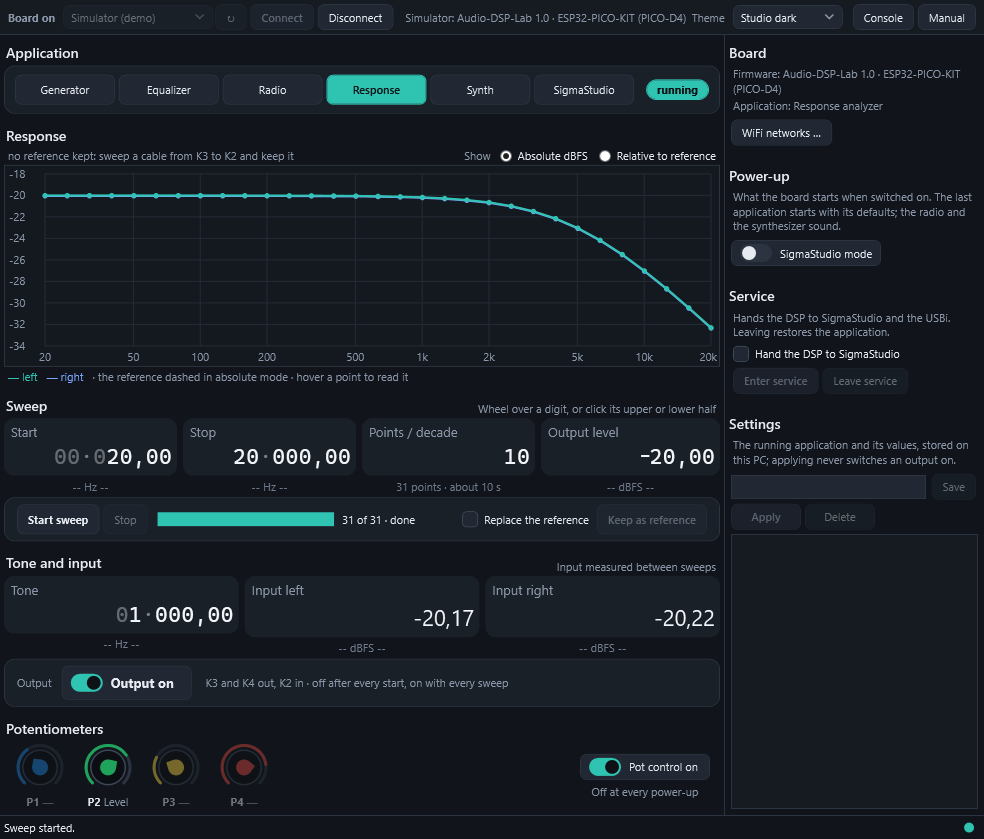

# Audio-DSP-Lab

Six audio instruments for the **Elektor Audio-DSP-FX board** (ADAU1701 DSP + ESP32), run from a Windows PC over USB.



| Application | What it does |
| --- | --- |
| **Generator** | Sine, rectangle, triangle, saw, inverse saw or noise, 20 Hz to 20 kHz, −60 to 0 dBFS; a width for the rectangle (pulse) and the triangle (rise) |
| **Equalizer** | Bass, middle and treble with adjustable frequencies on the line input |
| **Radio** | MP3 internet radio over WiFi, through the equalizer; eight editable stations |
| **Response** | Frequency response analyzer: sweeps a device under test, with a reference to subtract the board's own response |
| **SigmaStudio** | Runs your own SigmaStudio programs; the pots go to the DSP's auxiliary ADC, your program survives the other applications |
| **Synthesizer** | A Minimoog-style monophonic synthesizer: three oscillators, ladder filter, envelopes, two LFOs, glide, played from any MIDI keyboard |

The four pots on the board play the main values of each application, side by side with the PC. The board can start an application by itself at power-up and run without a PC. The window comes in three themes, Classic, Studio dark and Studio light.

## How it works

The ESP32 runs the Audio-DSP-Lab firmware. It writes each application's DSP program into the ADAU1701's EEPROM, computes the filters, reads the pots and MIDI, streams the radio and makes the synthesizer's sound. The PC application sets values and shows what the board reports, over a simple **text protocol** on the USB serial port: you can use the same protocol from a terminal or a script.

```
> app generator
< ok generator running
> set frequency 440
< ok 440
> set output on
< ok on
< ! value amplitude -14.27        (P2 turned on the board)
```


## Get started

1. Set the board's jumpers: **JP1 on ext. MCLK**, **JP2 on Selfboot**.
2. Download the latest **[release](https://github.com/andiepp/Audio-DSP-Lab/releases)** and unzip it.
3. Flash the firmware: `firmware\Flash-Firmware.cmd`, or in the browser with Espressif's web flasher.
4. Start `AudioDspLab.exe`, choose the board's COM port, **Connect**.

No board yet? Start the application and choose **Simulator (demo)**.

Step by step: **[Installation guide](docs/Installation.md)**.

## Documentation

| Document | For |
| --- | --- |
| [Installation guide](docs/Installation.md) | Preparing the board, flashing, installing, first steps, WiFi, MIDI |
| [Manual](docs/Manual.md) | Every application, the pots, stored settings, power-up, the synthesizer in depth, troubleshooting |
| [Protocol](docs/Protocol.md) | The serial protocol: commands, events, every parameter; for scripts and other front ends |
| [SigmaStudio](docs/SigmaStudio.md) | Your own DSP programs on the board; the built-in applications' projects |
| [Building from source](docs/Building.md) | Firmware and application builds, tests, releases, code structure |

## Requirements

- Elektor Audio-DSP-FX board v2.2, with either ESP32 kit: ESP32-PICO-KIT V4 (PICO-D4) or ESP32-PICO-KIT-1 (PICO-V3)
- Windows 10 or 11, 64-bit (the application is self-contained; nothing else to install)
- Optional: 2.4 GHz WiFi for the radio; a MIDI keyboard with DIN MIDI Out for the synthesizer; SigmaStudio 4.7 and a USBi for your own programs

Scripting works on any system: [tools/adl.py](tools/adl.py) is a Python client (needs pyserial).

## Repository

| Folder | Content |
| --- | --- |
| [firmware](firmware) | The ESP32 firmware (Arduino, ESP32 core 3.3.10) and the libraries it needs |
| [app](app) | The Windows application (.NET 10, WPF), its protocol library, a board simulator and tests |
| [sigmastudio](sigmastudio) | The DSP programs as SigmaStudio projects |
| [tools](tools) | Flash tool, release builder, Python client |
| [docs](docs) | The documentation |

## Licence

MIT for this project's own code: see [LICENSE](LICENSE). The compiled firmware includes third-party libraries under their own licences (GPL-3.0, RPSL, LGPL-2.1, Apache-2.0): see [THIRD-PARTY-NOTICES.md](THIRD-PARTY-NOTICES.md).

Audio-DSP-Lab is an independent project, not affiliated with Elektor or Analog Devices.
