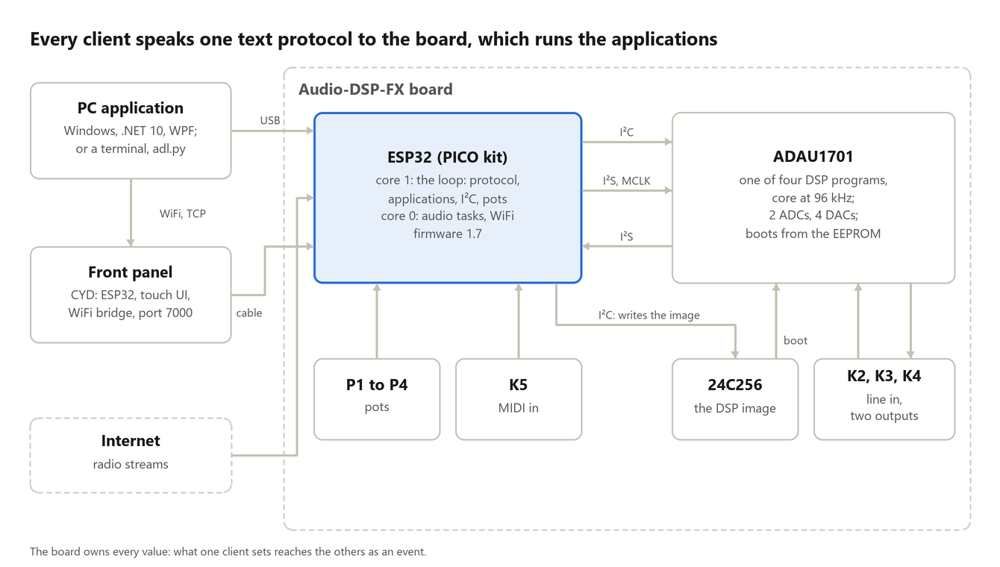
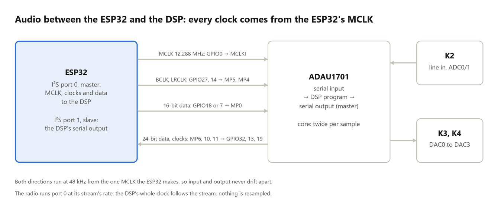
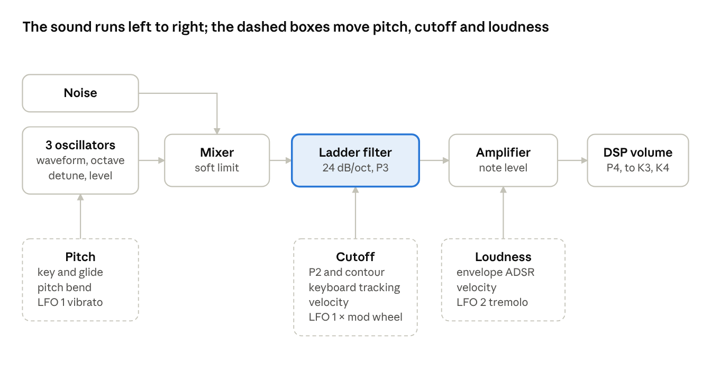
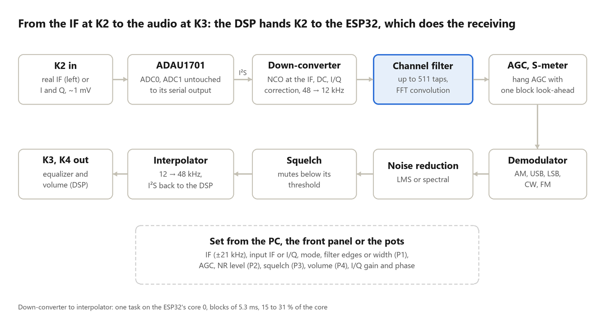

# Implementation Details

This document describes how Audio-DSP-Lab is built: the Elektor Audio-DSP-FX board with its ESP32 and ADAU1701, the DSP programs, the firmware that runs the seven applications, the text protocol, the signal processing on the ESP32 (the receiver's in detail), the front panel, the Windows application and the tools that build and check all of it. It is written for someone who wants to understand, change or extend the project; how to use it is in the [user manual](Manual.md), the protocol's commands in [Protocol.md](Protocol.md), the panel in [Panel.md](Panel.md) and the build steps in [Building.md](Building.md).

As of 2026-11-12, for firmware 1.7, application and panel firmware 1.7.2. The PDF, `Implementation-Details.pdf`, is made from this file by `python tools/Build-ManualPdf.py docs/Implementation-Details.md docs/Implementation-Details.pdf`.

## Overview

Audio-DSP-Lab turns the Elektor Audio-DSP-FX board into seven audio instruments run from a PC: a generator, an equalizer, an internet radio, an analyzer, a player for your own SigmaStudio programs, a synthesizer and an SDR receiver backend.

The board carries two processors that do very different work. The **ADAU1701** is a SigmaDSP: a fixed-point audio processor with two ADCs and four DACs, which runs a program made in Analog Devices' SigmaStudio and boots itself from an EEPROM. The **ESP32** (on an ESP32-PICO-KIT plugged into the board) is a general-purpose dual-core microcontroller with WiFi. Audio-DSP-Lab gives each the work it is good at: the DSP does the per-sample filtering, mixing and level control of every application at a fixed cost; the ESP32 generates and analyses signals, decodes the radio streams, runs the synthesizer and the whole receiver chain, and talks to the outside world. The two exchange audio over two serial audio ports, and the ESP32 controls the DSP over I²C.

The firmware on the ESP32 holds all seven applications. An application is a DSP program plus the ESP32 code that goes with it plus a table of parameters; starting one writes its DSP program to the EEPROM (if it is not already there), lets the DSP boot from it and sets every parameter. Everything that can be set is a named parameter, and every client (the Windows application over USB or WiFi, the front panel over its cable, a terminal, a Python script) sets it with the same text protocol.

### Design goals

- **One firmware, seven instruments.** No reflashing between applications: an application switch takes well under a second, and the DSP program of each comes with the firmware.
- **The board owns every value.** The PC application and the front panel show what the board reports, never what they asked for; a pot turned on the board, a value set from the panel and one set from the PC all end in the same place and are reported to everyone else.
- **One text protocol for everything.** Human-readable lines that work in a terminal, from Python and from the application alike; no binary framing, even for filter downloads and spectra.
- **Measured, not assumed.** The analyzer measures the board's own converters (THD+N about 0.017 % at −7 dBFS); the receiver is specified at its input (noise-equivalent 3.7 µV in 2.4 kHz) because its numbers were measured on the bench.
- **SigmaStudio stays usable.** The board remains an open SigmaDSP development board: SigmaStudio mode hands the DSP and its EEPROM to SigmaStudio's USBi, and the user's program is kept safe in the ESP32's flash while the firmware's own applications run.
- **Testable without hardware.** The PC side has a simulated board that answers the protocol as the firmware does; a test compares its tables with the firmware's source, so the two cannot drift apart.
- **Plain tools.** Arduino sketches built with arduino-cli, a .NET solution, PowerShell and Python scripts; one script builds a release.

### Who does what

| Part | Runs on | Does |
|---|---|---|
| DSP program | ADAU1701, 96 kHz core rate | Input and output mixing, the equalizer's biquads, volume and output switch, level and capture taps; one of four programs, chosen by the application |
| Board firmware | ESP32 core 1 (the loop) | The protocol on both serial ports, the application manager, all I²C traffic to the DSP and EEPROM, pots, events |
| Board firmware | ESP32 core 0 (tasks) | The audio tasks: generator, synthesizer, radio decoder, receiver chain, filter design, THD and spectrum analysis; WiFi |
| Panel firmware | ESP32 of the CYD | Touch UI from the board's parameter list; WiFi bridge on TCP port 7000 |
| Windows application | PC (.NET 10, WPF) | Pages for every application, plots, the receiver's filter tools, stored settings |
| Simulator | PC | A board in software for the demo, the tests and the screenshots |

### The life of a value

What happens when the user turns the equalizer's bass up on the PC:

1. The bass dial's view model sets the parameter `bass-gain`; the write is queued for that parameter. If the user keeps turning, only the newest value waits; it is sent when the previous write has been answered.
2. The protocol client sends `set bass-gain 6` over USB (or over TCP to the panel, which relays it on its cable).
3. The board's loop reads the line, finds the parameter in the running application's table, checks the range and calls the parameter's apply function with the scaled integer value 600 (6.00 dB).
4. The apply function computes the band's RBJ low-shelf coefficients in double precision at the DSP's core rate, converts them to the DSP's 5.23 fixed-point format and writes them with two safeloads, one for each channel's biquad. The DSP takes them at its next sample, without a click.
5. The board answers `ok 6` to the port that asked and sends `! value bass-gain 6` to every other port with events on, for instance the panel, which redraws its curve.
6. The PC shows the value from the answer, not the one it sent.

### Repository map

| Path | Holds |
|---|---|
| `firmware/AudioDspLab` | The board firmware (Arduino sketch, about 9,400 lines) |
| `firmware/AudioDspLabPanel` | The front panel firmware (Arduino sketch with LVGL) |
| `firmware/libraries` | arduino-audio-tools, libhelix (the MP3 decoder) and a trimmed LVGL 9.2.2 with its `lv_conf.h`, in the versions used |
| `sigmastudio` | The SigmaStudio projects of the DSP programs, their exports and notes |
| `app` | The Windows application: `AudioDspLab.Core` (protocol, simulator, receiver math), `AudioDspLab` (WPF), tests, the screenshot tool |
| `tools` | Release build, flash tool, PDF builder, panel screen capture, image converters, CAD renderer, the Python client `adl.py` |
| `docs` | Manual, installation guide, protocol, panel, SigmaStudio, building, this document; images |
| `design` | Design documents of larger changes (the receiver) |
| `CAD` | STL files of the box and the panel case |

### Releases so far

| Release | Brought |
|---|---|
| 1.0 | Generator, equalizer, radio, analysis, SigmaStudio mode; PC application |
| 1.1 | Front panel (CYD) on the board's second serial port; WiFi control through the panel |
| 1.2 | Analysis with THD, THD+N and spectrum; the true 12.288 MHz MCLK (the DSP core at 96 kHz) |
| 1.3 | The spectrum on the front panel |
| 1.4 | Serial terminals on both ports |
| 1.5 | The SDR receiver |
| 1.6 | The receiver as a backend only (front-end control removed) |
| 1.7 | The receiver's IF back at 10 kHz |
| 1.7.1, 1.7.2 | Panel firmware only: the two-USB CYD, then display detection |

## The board

The Elektor Audio-DSP-FX board carries the ADAU1701 with its converters and connectors, a 24C256 EEPROM, four pots, a MIDI input and a socket for an ESP32 kit.

### The hardware

| Part | Role |
|---|---|
| ADAU1701 | SigmaDSP with 2 ADCs (line input K2) and 4 DACs (outputs K3 and K4, the same signal on both); I²C address 0x34; self-boots from the EEPROM |
| 24C256 | 32 KB EEPROM at I²C address 0x50, 64-byte pages; holds the DSP program the DSP boots from; write protect on ESP32 GPIO21 |
| ESP32-PICO-KIT | V4 with the ESP32-PICO-D4, or ESP32-PICO-KIT-1 with the PICO-V3; the firmware tells them apart from the chip's efuses |
| P1 to P4 | Pots on ESP32 ADC inputs GPIO35, 34, 39 and 36 |
| K5 | MIDI input (3.5 mm TRS type A) for the synthesizer |
| 74HC4053 and the ESP32's DACs | In SigmaStudio mode only: pass the pots to the DSP's auxiliary ADC inputs |

Jumpers: JP1 on "ext. MCLK" (the ESP32 makes the DSP's clock), JP2 on "Selfboot". The DSP's reset is ESP32 GPIO12, active low; the I²C bus is GPIO9 (SDA) and GPIO10 (SCL) at 400 kHz.

### Clocks

The DSP needs a master clock of 256 × fs = 12.288 MHz for 48 kHz. The ESP32 makes it on GPIO0 from its audio PLL (APLL), through I²S port 0 with only the MCLK output routed (`Mclk.cpp`). The DSP needs this clock before its reset ends, so `setup()` starts it before anything touches the DSP.

There is a trap in the ESP32's driver: GPIO0 carries the APLL itself, and the driver sets the APLL to twice the port's MCLK because its divider cannot go below 2. A requested 256 × fs therefore gave 24.576 MHz on the pin: the DSP ran at twice its rating, and its converters made sporadic single-sample errors, found only when the serial-output capture recorded them. The firmware asks for 128 × fs (`DSP_MCLK_I2S_MULTIPLE`), and 12.288 MHz appears on the pin. A second trap: GPIO0 must not be probed with the pulse counter, because claiming the pin as an input takes it off the clock output.

The SigmaStudio projects carry the core register of Elektor's demo programs (program length 512 instructions), so the DSP's core runs **twice per sample**: the core rate is 96 kHz, and every DSP frequency (the equalizer's biquads, for instance) is computed for 96 kHz. With the radio playing, the sample rate follows the stream (44.1 kHz for most stations), the core rate becomes 88.2 kHz and the equalizer's coefficients are computed again.

Only one owner can hold I²S port 0. An application that streams audio to the DSP stops the bare MCLK and runs I²S port 0 itself, with the same APLL setting, so the clock never stops; when it ends, the bare MCLK starts again.

### Audio between the ESP32 and the DSP

**ESP32 to DSP** (`AudioOut.cpp`): I²S port 0 as master, 48 kHz, 16-bit stereo, Philips format: BCLK on GPIO27 to the DSP's MP5, LRCLK on GPIO14 to MP4, data on GPIO18 (PICO-D4) or GPIO7 (PICO-V3) to MP0. The DMA queue is 4 × 64 frames (about 5 ms; the audio library's default of close to 100 ms was too long to play an instrument with); the receiver uses 8 × 64 frames. On an underrun the port sends silence.

**DSP to ESP32** (`Capture.cpp`): the DSP's serial output port is the master (the DSP programs set it so); I²S port 1 of the ESP32 receives as slave: data from MP6 on GPIO32, LRCLK from MP10 on GPIO13, BCLK from MP11 on GPIO19, 32-bit slots with 24 bits of data, 64 BCLK per frame. A slave's own clock must run at 8 times BCLK (`mclk_multiple` 512 from the 160 MHz PLL); at 4 times it miscounted frames. The analyzer captures 9,728 frames (about 0.2 s) per measurement, at most 48,000; the receiver keeps the stream open and takes blocks of 256 frames (5.33 ms). The capture needs no I²C and therefore also works in service mode.

### Memory and CPU

| Resource | Use |
|---|---|
| Flash | Partition scheme "Minimal SPIFFS" (1.9 MB application); the firmware fills about 65 %; the raw `spiffs` partition holds the backup of the user's SigmaStudio program |
| Heap | THD and spectrum need about 82 KB (one 32 KB block and three of 16 KB); the receiver chain about 53 KB in pieces of at most 13 KB; after the radio has played, about 193 KB are free in smaller pieces |
| Core 1 | The loop, which never yields: protocol, application manager, I²C, pots, events |
| Core 0 | WiFi and lwIP, and every audio task, pinned there |
| CPU of the receiver | 15 to 31 % of core 0 (worst-case benchmark 26 % of a block with `RxChain.cpp` at -O2, 34 % at -Os) |

## The DSP programs

Four small SigmaStudio programs serve the seven applications; the ESP32 computes all their coefficients and changes them while they run.

### Four images for seven applications

| Program | Used by | Signal flow |
|---|---|---|
| Equalizer | Equalizer | K2 (ADC0, ADC1) → bass, middle, treble biquads → volume (RC slew) → K3 and K4 |
| Radio | Generator, Radio, Synthesizer | The Equalizer with its input moved to the serial input from the ESP32 |
| Receiver | Receiver | The Radio, plus ADC0 and ADC1 untouched to the serial output (I and Q, or the IF, to the ESP32) |
| Analysis | Analysis | A sine → amplitude (RC slew) → K3 and K4; per channel K2 → band-pass → rectifier → smoothing → level readback; K2 untouched to the serial output |

In every project the input cell's channels 0 and 1 are ADC0 and ADC1 (K2 left and right), channels 2 and 3 the serial input's left and right; DAC0 and DAC1 feed K3, DAC2 and DAC3 feed K4; the serial output's two slots go to the ESP32. The Equalizer, Radio and Receiver programs keep their cells at the same addresses, so one piece of firmware code drives all three. The generator and the synthesizer make their sound on the ESP32 and play it through the Radio program, whose equalizer they set flat.

A fifth project, Generator, made its signals in the DSP; it was the starting point of the others and is not in the firmware.

| Program | Image bytes | Instructions (of 512) | Parameter words | Data words |
|---|---|---|---|---|
| Analysis | 800 | 98 | 25 | 52 |
| Equalizer | 832 | 94 | 34 | 54 |
| Radio | 832 | 98 | 34 | 56 |
| Receiver | 864 | 102 | 34 | 56 |

SigmaStudio's compiler reports "out of 1024" instructions, its count for a program that runs once per sample; the projects run twice per sample (section 2.2), which leaves 512. All four use less than a fifth of that.

### From SigmaStudio to the firmware

In SigmaStudio, "Write Latest Compilation to E2PROM" makes the self-boot image (`E2Prom.bin`) and "Export System Files" the headers with the parameter addresses; both must come from the same compile, because addresses can move. `tools/Convert-E2PromImage.ps1` turns the image into `DspImage*.h`, a byte array with its length; it checks that the image fits the 24C256 and starts with a write message. The parameter addresses are copied by hand from the export's `*_IC_1_PARAM.h` into `Applications.cpp` and `Analyzer.cpp`.

The image is the ADAU1701's self-boot message stream: write messages (0x01, a length, the chip address, a register or RAM address, data), no-ops and an end message. Every image has the same order: the core register, the interface registers, parameter RAM from address 0, program RAM from 0x0400 (five bytes per instruction), the control registers from 0x081C to 0x0827, the core register again, end. The control registers make the serial output port a master (48 kHz, 64 bit clocks per frame), the serial input an I²S slave, and route the multipurpose pins to the serial ports and the auxiliary ADCs.

### Parameters at run time

The firmware writes parameters with the ADAU1701's **safeload**: up to five words go to the safeload data registers (0x0810 to 0x0814, a 5.23 fixed-point word each), their addresses to 0x0815 to 0x0819, and setting the IST bit of the core register (read, modify, write, so the program length is kept) makes the DSP take them all at the next sample. One biquad is five words, so each channel's band changes in one step, without a click or an unstable intermediate filter.

Values are 5.23 fixed point, clamped to [−16, 16). Biquads are stored as B0, B1, B2, A1, A2 with the feedback coefficients negated (the export calls them A0 and A1). All coefficients are computed on the ESP32 in double precision for the core rate:

- **Equalizer:** RBJ cookbook low shelf and high shelf (slope 1) and peaking filter (Q 0.7); gains ±12 dB; bass 50 to 400 Hz, middle 300 Hz to 5 kHz, treble 500 Hz to 8 kHz; volume −60 to 0 dB as a linear gain to an RC-slewed gain cell, so it never clicks; output off is gain 0.
- **Analysis:** an RBJ band-pass with Q 5 and 0 dB at its centre (at 20 Hz its poles lie within 0.0007 of the unit circle, which is why double precision matters), and a one-pole smoothing at f/32 written as two raw words that add up to exactly 2²³, so its DC gain is exactly 1.

The analyzer reads its two levels through the ADAU1701's data-capture registers: the firmware writes a capture setting (the trap address of the level cell) to 0x081A or 0x081B and reads three bytes back, a 5.19 value.

The images boot with their SigmaStudio defaults (the equalizer's bands at +6 dB, deliberately, so the export could be checked against the firmware's formulas); the firmware overwrites every parameter right after the boot.

### SigmaStudio mode

In SigmaStudio mode the DSP runs the user's own program from the EEPROM, written there by SigmaStudio's USBi on the board's I²C header (section 4.7). The firmware supplies the clock and nothing else, with one service: the pots. The ADAU1701's auxiliary ADC inputs are reached through the ESP32's two DACs (GPIO25 and 26) and a 74HC4053 multiplexer (selected by GPIO5 and 15): each DAC serves two inputs, 10 ms each, so every pot reaches its ADC (P1 to ADC0 on MP9, P2 to MP2, P3 to MP3, P4 to MP8) every 20 ms, with 8 bits. A program can therefore use the board's pots as SigmaStudio's auxiliary inputs.

A USBi left on the header makes every EEPROM access of the firmware fail, and the switch away from SigmaStudio mode is then refused; the manual says to unplug it first.

## The firmware's runtime

The board firmware is one Arduino sketch: a loop on core 1 that owns the serial ports and the I²C bus, and audio tasks on core 0 that exist only while their application runs.

### Modules

| Module | Role |
|---|---|
| `AudioDspLab.ino` | `setup()` and `loop()` only |
| `Config.h` | Versions, pins, I²C addresses, clock rates, and the reasons behind them |
| `Board.cpp` | Tells the two ESP32 kits apart and picks the I²S data pin |
| `Dsp.cpp` | ADAU1701 reset and boot wait, safeload, parameter and capture readback |
| `Eeprom24.cpp` | 24C256 compare, page write with verify, write protect, bus recovery and retry |
| `StudioBackup.cpp` | The copy of the user's SigmaStudio program in the `spiffs` partition |
| `Mclk.cpp`, `AudioOut.cpp`, `Capture.cpp` | The DSP's clock, the stream to the DSP, the capture of the DSP's output |
| `Pots.cpp`, `DacMux.cpp` | The pots; their path to the DSP's auxiliary ADC in SigmaStudio mode |
| `Applications.cpp`, `ParamInfo.cpp` | The application manager and its tables; the parameters' protocol names, kinds, units and choices |
| `Protocol.cpp`, `Errors.h` | The text protocol on both ports; the error codes |
| `Generator`, `Oscillators.h`, `Synth` | Generator and synthesizer |
| `Radio` | Internet radio |
| `Analyzer`, `Distortion` | Frequency response; THD and spectrum |
| `Receiver`, `RxChain` | The receiver's task and its signal chain |
| `DspImage*.h` | The DSP programs as EEPROM images |

### Boot and loop

`setup()` runs in an order that the hardware dictates:

1. `dspInit()` holds the DSP in reset (GPIO12 low).
2. `eepromInit()` sets write protect (GPIO21 high) and records the bus lines' state.
3. `protocolInit()` opens both serial ports.
4. The I²C bus starts at 400 kHz.
5. `mclkStart(48000)`: the DSP needs its clock before its reset ends.
6. `potsInit()`.
7. `appsInit()` starts SigmaStudio mode, or the last application when the power-up option is on.
8. `protocolReady()` sends `! ready Audio-DSP-Lab 1.7 1` on both ports, after a line feed that ends whatever the boot ROM printed.

`loop()` is two calls: `protocolPoll()` and, outside service mode, `appsPoll()`. The rule behind the whole firmware is that **the loop alone talks to the DSP and the serial ports**: every I²C transfer and every protocol line happens in loop context, so there is no locking around the bus or the ports. The loop never yields core 1; that is why every task is pinned to core 0, beside WiFi.

### Tasks

| Task | Priority | Stack | Exists while |
|---|---|---|---|
| generator | 3 | 4096 | the generator runs |
| synth | 3 | 4096 | the synthesizer runs |
| radio | 2 | 8192 | the radio runs |
| receiver | 4 | 6144 | the receiver runs (above the generator and synthesizer) |
| rx-design | 1 | 4096 | the receiver runs: designs channel filters below the audio task |
| distortion | 1 | 4096 | THD or spectrum is measured (the radio is not running then) |

All are on core 0. An application's `begin` creates its task and `end` deletes it; `end` must be safe to call twice.

### Starting an application

An application is a row of the table in `Applications.cpp`: id, name, DSP image, parameters, pot mappings, `begin` and `end`.

| Id | Application | DSP image | Parameters | Pots |
|---|---|---|---|---|
| 0x01 | Signal generator | Radio | 6 | 4 |
| 0x02 | Equalizer | Equalizer | 8 | 4 |
| 0x03 | Internet radio | Radio | 9 | 4 |
| 0x04 | Analysis | Analysis | 6 | 1 |
| 0x05 | SigmaStudio mode | none | 0 | 0 |
| 0x06 | Synthesizer | Radio | 48 | 4 |
| 0x07 | SDR receiver | Receiver | the receiver's set | 4 |

`start()` switches, step by step:

1. The state becomes LOADING; the DSP is held in reset.
2. `takeBusBack()` restarts the ESP32's I²C driver: another master (SigmaStudio's USBi) may have used the bus and left the driver in an error state.
3. The analyzer stops. Leaving SigmaStudio mode also ends the pot multiplexer and sets write protect.
4. Leaving SigmaStudio mode (or at power-up), the user's program in the EEPROM is saved to flash (section 4.7). If that fails, the switch is refused with `eeprom-failed` and the board stays in SigmaStudio mode, so the program is never lost.
5. The old application's `end()`, the new one's `begin()`; an application without a stream starts the bare MCLK.
6. The EEPROM is compared with the application's image and written only where it differs: switching between two applications that share an image (generator, radio and synthesizer all use the Radio program) writes nothing.
7. The DSP leaves reset and boots itself from the EEPROM; the firmware waits for it to answer on I²C (50 ms, then a poll every 50 ms, up to 1.5 s).
8. Every parameter gets its default, or its kept value when an application resumes; with pot control on, the pot-driven ones take the pots' positions.
9. Every parameter's apply function runs in table order, which writes the DSP's coefficients and sets up the ESP32's code.
10. The state becomes RUNNING, and `! status` goes to every port.

### Parameters

A parameter is a `ParamDef`: id, minimum, maximum, default and an apply function, all on **scaled integers** (0.01 dB, 0.01 Hz and so on), so the firmware never parses or compares floating-point text. `ParamInfo.cpp` adds what the protocol shows: the name, the kind (number, integer, switch, choice), the decimals, the unit and the choices. `params` lists all of this, one line per parameter, and both the panel and the PC build on it.

`appParamSet` checks the range (an out-of-range error names the range), calls the apply function with the new value before it is stored (so a band can read its partner value from the table) and then disengages the pot of that parameter: after a value is set from the PC, the pot must move again before it overrides it. An apply function either writes DSP coefficients (equalizer bands, levels) or calls the ESP32 code (`generator…`, `synthSet…`, `radioSelect`, the receiver's `rxApply`, which only marks what has to be computed again).

Parameter values are not stored: an application starts with its defaults, unless the PC application's stored settings are applied. What the board stores is listed in section 4.8.

### Pots and pot control

The pots are read every 20 ms (12-bit ADC at 11 dB, smoothed with an IIR of 0.25). Stock pots stop well below the ADC's full scale (3230 to 3370 of 4095), so 3200 counts as full scale; a board whose pots reach higher learns its own top (stored in NVS when it has risen by 64). Each application maps its pots to parameters with a function from the raw reading to the scaled value, for example P2 to the generator's frequency in the decade `p2-range` sets.

Pot control is off at every power-up. Turned on, the pots take over at once; after a value is set from a client, its pot must move by 80 counts to take over again. A backlash of 28 counts keeps a pot from jittering a value, and the ends of the travel snap to the range's ends.

### EEPROM, backup and service mode

The DSP is the I²C master while it boots itself, so the EEPROM is only written **while the DSP is held in reset**. A write takes write protect off, writes 64-byte pages that never cross a page boundary, polls for the write cycle's end (up to 20 ms per page), sets write protect and verifies the whole image by reading it back. An 832-byte image is 13 pages. Reads go in 32-byte chunks; a failed read frees the bus (up to nine clock pulses until SDA is released, then START and STOP) and retries after 0, 5 and 50 ms. The DSP only self-boots when write protect is high at the rising edge of reset.

**SigmaStudio mode** gives the DSP back to SigmaStudio: the firmware restores the user's program from flash into the EEPROM (only if the EEPROM holds one of the firmware's images), lets the DSP boot (600 ms: a self-boot reads at most 9,248 bytes at 384 kHz), takes write protect off so the USBi can write the EEPROM, starts the pot multiplexer and stays off the bus.

**The backup** (`StudioBackup.cpp`) lives in the raw `spiffs` partition: a header with the magic "AMLS", the length and a CRC-32, up to 16 KB of image. It is saved only when the EEPROM holds something that is not one of the firmware's own images and not already saved; the firmware's images are recognised by comparing the EEPROM with the arrays. A failed read is never taken for an empty EEPROM: that would let a firmware image overwrite the user's program.

**Service mode** is the Elektor demo sketch's PROG mode: the application ends, MCLK runs at 48 kHz, write protect is off, the DSP's reset is released and the firmware stays off the bus, so SigmaStudio can program the EEPROM of a running application's DSP. Leaving it restarts the application, which writes the application's image again.

### What is stored

| NVS namespace | Holds |
|---|---|
| `aml-startup` | The power-up option and the last application |
| `adl-pots` | The learned pot tops |
| `adl-wifi` | Two WiFi networks (SSID and password) for the radio and the panel |
| `aml-radio` | The eight stations: names and URLs |
| `aml-ref` | The analyzer's reference sweep |

The `spiffs` partition holds the SigmaStudio backup. The front panel keeps only its brightness (namespace `adl-panel`).

## The protocol

The board speaks one line protocol on two serial ports; the full command list is in [Protocol.md](Protocol.md). This chapter is about how it works.

### Ports

| Port | Physical | Settings |
|---|---|---|
| USB | UART0 through the kit's CP210x | 921,600 baud, 8N1; RX buffer 1 KB, TX 2 KB |
| Panel | UART2: RX GPIO37 (input only, 10 kΩ pull-up recommended), TX GPIO4 (the pad of the unfitted R36) | 115,200 baud, 8N1 |
| WiFi | Not on the board: the panel serves TCP port 7000 and relays to the panel port | One PC at a time |

Each port has its own line buffer, terminal flag, event switch and a 64-bit mask of values waiting to be reported to it. On the USB port, DTR and RTS must both be deasserted (or both asserted): they are the kit's reset and boot lines. Every client in the project, in C#, Python and PowerShell, deasserts both.

### Lines

A request is one line, `<command> [arguments]`, at most 320 bytes, ended by LF, CR or CR LF. The answer is zero or more data lines starting `* `, then exactly one `ok [values]` or `err <word> <text>`. Events start `! ` and come only between answers, never inside one. Arguments are words; a quoted string may contain spaces and `\"` and `\\`. Numbers are written in invariant culture with at most two decimals; `-` means no value.

A request ended by CR alone switches its port into **terminal mode**: the board echoes what is typed, handles Backspace and ends its lines with CR LF, so a plain serial terminal works. A request ended by LF switches back.

There is no binary data. A spectrum is 256 lines `* i hz left right`; a recording is hex, 16 frames per line; a receiver filter is downloaded as `rxfilter load <taps> real|complex`, `rxfilter data` lines of up to 16 floats and `rxfilter end <crc32>`, where the PC writes the floats with nine significant digits (exact for float32) and the CRC is computed over their bytes.

### Commands

| Group | Commands |
|---|---|
| General | help, ping, echo, info, events, status, reset, led |
| Applications | apps, app, params, get, set, pots, potctl, startup, service |
| Radio and network | stations, station, radio, wifi, panel |
| Analysis | sweep, points, reference, thd, harmonics, spectrum, level |
| Synthesizer | voice, midi, load |
| Receiver | meter, rxfilter |
| SigmaStudio mode | aux, backup |
| Diagnostics | diag boot, heap, dsp, eeprom, scan, tone, meter, blocks, thd-test, capture, record, rx, clocks, raw and more |

### Events and the other ports

Events are checked every 20 ms, and only when some port has them on (`events on`). `status`, `wifi` and `panel` are always sent; the others are throttled and suppressed in service mode:

| Event | Sent when | Throttle |
|---|---|---|
| `value` | a parameter changed from another port or a pot | 50 ms per port |
| `pots` | a pot moved by 80 counts | 100 ms |
| `radio`, `title` | the stream's state or title changed | |
| `sweep`, `point` | a sweep starts, ends or measures a point | |
| `thd`, `spectrum` | a new result | |
| `voice` | the synthesizer's gate or note changed | 50 ms |
| `meter` | the receiver's S-meter | 200 ms |

A value set from one port is reported to the other ports as `! value`, never back to the port that set it: that port has its answer. The panel and the PC can therefore work at the same time; the panel, which relays the PC's requests over WiFi on its single cable, mirrors those answers into its own model (section 8.5).

### Errors and resynchronisation

Errors are a word and a text: `unknown-command`, `bad-argument`, `out-of-range` (with the range), `unknown-parameter`, `line-too-long`, `unknown-application`, `eeprom-failed`, `dsp-not-responding`, `service-mode`, `dsp-write-failed`, `wrong-application`, `no-sweep`, `store-failed`, `no-clock`, `busy`, `no-memory`, and for the filter download `count-wrong`, `crc-wrong`, `not-loading`.

Every start sends `! ready Audio-DSP-Lab 1.7 1` (name, firmware, protocol version) on both ports, and `info` answers the same plus the kit. A client that timed out cannot know whether a late answer is still on its way, so before its next request it sends `echo <token>` and discards everything up to `ok <token>`. A `! ready` in the middle of a request means the board restarted: the request fails, the connection stays, and the client resynchronises the same way.

## Signal processing on the ESP32

The ESP32 makes the generator's and the synthesizer's sound, decodes the radio, and analyses what comes back on K2; the DSP does the level and filtering around it.

### The generator

The generator's task (core 0, priority 3) makes blocks of 64 frames at 48 kHz and writes them to the DSP's serial input; the DSP's volume cell sets the amplitude (−60 to 0 dBFS), so every waveform is made at full scale and none loses resolution at low levels.

- **Frequency:** a 32-bit phase accumulator, increment = round(f / 48,000 × 2³²), which resolves 11 µHz; the protocol sets 20 Hz to 20 kHz in 0.01 Hz steps.
- **Sine:** `sinf(2π × phase)` per sample, no table.
- **Rectangle and saw:** PolyBLEP at each edge, which removes most of the aliasing a naive edge would fold back. The rectangle's mean is removed and its level scaled by 1 / (1 + |1 − 2w|), so it still peaks at full scale at any width (5 to 95 %).
- **Triangle:** PolyBLAMP at its corners; the rise is the width, at least two samples each way.
- **Noise:** xorshift32.
- **Waveform change:** a fade out over 5 ms, the switch at silence, a fade in, so a change never clicks.

The oscillators are shared with the synthesizer (`Oscillators.h`).

### The synthesizer

One monophonic voice in the Minimoog's manner, computed in blocks of 64 frames (1.33 ms) at 48 kHz on core 0:

- **Three oscillators** (sine, saw, rectangle, triangle), each with an octave (−2 to +2), oscillators 2 and 3 with a detune of ±700 cents; rectangle width 5 to 95 %, triangle rise 10 to 90 %; band-limited with PolyBLEP and PolyBLAMP as the generator's; free-running (no phase reset on a new note); an oscillator at or above half the sample rate is muted.
- **Mixer:** each source at 100 % gives −6 dBFS, the sum goes through a soft limiter (linear to 0.5, then tanh towards 1).
- **Filter:** a four-pole ladder low-pass in zero-delay-feedback form (four topology-preserving one-poles, after Zavalishin), with the input saturated by 2 tanh(x/2) (a rational approximation, within 2 % up to |x| = 3). The feedback runs to 4.2 and self-oscillates from 4; a make-up gain of 1 + k/4 keeps the passband level. The cutoff, in octaves, sums the knob, the key tracking, the velocity's brightness (up to 3 octaves), LFO 1 through the mod strip (±2 octaves) and the contour envelope (up to 5 octaves); g = tan(π fc / fs) is computed every fourth sample (12 kHz), the cutoff clamped to 10 Hz to 0.45 fs.
- **Envelopes:** amplitude and contour; linear attack, exponential decay and release that reach 1 % of their target in the time set (4.6 time constants), 1 ms to 10 s.
- **LFOs:** LFO 1 for vibrato (up to 1,200 cents, through the mod strip), LFO 2 for tremolo and pulse-width modulation (up to ±45 % of the cycle); sine, triangle with symmetry, or square, 0.1 to 20 Hz; computed once per block.
- **Playing:** single trigger, last-note priority over a stack of 16 held keys, glide to 5 s, pitch bend to 12 semitones, velocity to loudness.

**MIDI** comes from K5 through an opto-coupler on GPIO38 (UART1, 31,250 baud, receive only). The parser honours running status, ignores real-time bytes anywhere and listens to one channel (15 by default). CC1 is the mod strip; CC120 and CC123 silence the voice. The parser runs in the loop on core 1; the task reads its results. The synthesizer's CPU share is measured per block and reported.

### The radio

The radio uses arduino-audio-tools with libhelix's MP3 decoder: an ICY stream (MP3 over plain HTTP; the stream's title comes from its ICY metadata), the decoder, and the library's I²S output, in a task on core 0 at priority 2, beside WiFi. There is **no resampling**: the I²S port runs at the stream's rate (44.1 kHz for most stations), with the same APLL setting as the bare MCLK, so the DSP's whole clock follows the stream; the loop then computes the equalizer's coefficients again for the new core rate.

The task handles the network's troubles itself: WiFi connect 10 s, retry after 30 s; a stream without audio for 8 s counts as failed and is retried after 5 s; the socket is closed before WiFi goes down (otherwise lwIP could crash). It never touches I²C; state and title go to the loop, which reports them as events. The eight stations (name and URL) are kept in NVS; a slot never written holds its default, and writing the default removes the key.

### Frequency response

The sweep is measured **in the DSP**, not on the ESP32. The Analysis program plays a sine and measures what returns on K2 with a band-pass (Q 5) tuned to the sine, a rectifier and a smoothing at f/32; the ESP32 reads the two levels through the capture registers and scales the rectified mean by π/2 to the sine's peak in dBFS (floor −140 dBFS).

Points are spaced evenly on a log axis, N = decades × points per decade + 1, at most 128. Each point waits 40 periods (at least 20 ms, the first 150 ms more) for the filters to settle, then takes eight readings over half a period (one ripple period of the rectified sine) and averages them. The sweep is a state machine stepped by the loop, so the protocol keeps answering during a sweep; 10 points per decade take about 10 s, with a floor of about −110 dBFS. The last sweep can be kept as the reference (in NVS); relative values interpolate the reference on a log axis.

### THD and spectrum

THD and spectrum use the ESP32's FFT on the DSP's serial output, which carries K2 untouched. A task on core 0 (priority 1, about 82 KB of heap while it runs) alternates the channels: 8,192 frames per capture (0.17 s), four captures averaged per channel, a new result about every 1.6 s.

- **Window:** the mean removed, then a periodic four-term Blackman–Harris window (side lobes below −92 dB).
- **FFT:** the real 8,192-point FFT as a 4,096-point complex esp-dsp FFT plus the even/odd split, in single precision; bins of 5.859 Hz.
- **Fundamental:** the strongest bin of L + R between 20 Hz and 20 kHz; its frequency is the power-weighted centre of ±4 bins, its power the sum over the main lobe.
- **Harmonics:** H2 to H10 up to 20 kHz, each searched within ±2 bins and summed over ±4.
- **THD** = harmonics / fundamental; **THD+N** = everything from 20 Hz to 20 kHz but the fundamental's lobe / fundamental.
- **Tone on a bin:** the analyzer moves its tone to the centre of a bin (1,000 Hz plays as 1,001.95 Hz), so the fundamental does not leak.
- **Spectrum:** RMS over 20 Hz to 20 kHz and the five strongest peaks (with ±8 bins masked around each); the plot is 256 points spaced logarithmically from 20 Hz to 24 kHz, each the strongest bin in its range.

A built-in self-test feeds a synthetic tone with known harmonics through the same code. Measured on the board itself, K3 cabled to K2: at −7 dBFS THD 0.016 % and THD+N 0.017 % (H2 −81, H3 −78 dBc); with the input open, −97.5 dBFS RMS.

## The receiver backend

The receiver is the back end of a software-defined radio receiver, from the IF on: the DSP passes K2 to the ESP32, the ESP32 runs the whole chain and sends audio back to the DSP. Its design history is in [design/receiver.md](../design/receiver.md).

### Defined at its input

The front end (antenna to IF or I/Q) is the user's, so the receiver is specified where it begins, at K2 (about 22.5 kΩ, sampled at 48 kHz):

| Figure | Value |
|---|---|
| Full scale | 2.98 Vpp (+2.7 dBu) |
| Noise-equivalent input in 2.4 kHz | 3.7 µV RMS per channel with I/Q; 5.4 µV RMS with an IF |
| Dynamic range in 2.4 kHz | About 109 dB (I/Q), 106 dB (IF) |
| Rule for a front end | About 1 mV amplitude at K2: −63.5 dBFS, 42 to 46 dB above the noise, about 63 dB below clipping |
| Tuning | ±21 kHz around the I/Q centre (or the IF), filter edges up to ±5.5 kHz from the carrier |

Nothing on the board limits the band above 24 kHz, so the front end must low-pass its output. Internally, levels are dB relative to 32,768 counts, the scale of the AIC23 codec in the DSP-Box receiver this chain was ported from, so every level means what it meant there.

### The chain

The receiver's task (core 0, priority 4, above the generator and synthesizer) takes blocks of 256 frames (5.33 ms) of 24-bit I/Q from the capture port and returns 256 frames of 16-bit audio to the DSP's serial input, which plays them through the Radio program's equalizer and volume. Both directions run from the MCLK the ESP32 makes, so they never drift and nothing is resampled. The output ring holds two blocks (8 × 64 frames): with one, an unlucky phase between the two ports ran it dry.

1. **Down-converter:** DC removal (a one-pole tracker at about 2 Hz per channel), the I/Q correction (Q' = kq Q + ki I, with kq = 1 / (g cos p) and ki = −tan p, for ±3 dB and ±10°), a mixer with a 32-bit NCO (a 1,024-entry sine table with linear interpolation), a 43-tap Kaiser low-pass (80 dB, cutoff 6 kHz) and decimation by 4 to **12 kHz complex**, 64 samples per block. With a real IF the input is 2x instead of I + jQ. In CW the mixer sits at the IF minus the pitch, so a carrier on the dial sounds at the pitch.
2. **Channel filter:** a complex FIR of up to 511 taps (section 7.3).
3. **AGC and S-meter** (section 7.4).
4. **Demodulator:** AM, USB, LSB, CW, FM, or off.
5. **Noise reduction:** LMS or spectral.
6. **Squelch:** opens when the AGC's peak reaches the threshold (−150 to 0 dBFS), with a gain ramp over one block.
7. **Up-converter:** interpolation by 4 with a polyphase 43-tap Kaiser filter back to 48 kHz, real, the same on both channels.

`RxChain.cpp` alone is compiled with -O2 (the rest of the firmware is -Os, which would cost about a third more here).

### The channel filter

The filter is designed on the board from its two edges and the stop band. A real Kaiser low-pass of half the bandwidth (normalised to unity gain) is shifted to the passband's centre, which makes it complex and one-sided: USB passes only positive frequencies, so the other sideband is gone before the demodulator. The edges are the −6 dB points relative to the carrier, within ±5.5 kHz and at least 50 Hz apart; the transition is a quarter of the width, 60 to 300 Hz; the length follows Kaiser's formula for the stop band (40 to 100 dB), made odd and capped at 511 taps, beyond which the transition widens instead. USB at 2.4 kHz and 80 dB takes 203 taps, a delay of 8.4 ms.

A direct-form FIR of 511 complex taps took 40 % of a block at -O2 (71 % at -Os), and esp-dsp's assembler FIR routines were no faster than plain C. The filter therefore runs as a **uniformly partitioned overlap-save convolution**: blocks of 64 samples, a complex FFT of 128 points, up to 8 partitions and a delay line of 8 input spectra; Y = Σ Hp X(t − p), the inverse FFT done as conjugate, forward FFT, conjugate. The result is exactly the direct form's, with no added delay, in about a tenth of the time: 4 % of a block for 511 taps.

New filters are designed in a background task (core 0, priority 1, about 6.5 µs per tap, 3.3 ms for 511) into the inactive one of two coefficient sets; the audio task swaps the sets at a block boundary, and because both share the input history, the swap is click-free. A generation counter discards a design that a newer request has overtaken.

The PC can download a filter instead (`rxfilter`, section 5.2): up to 511 real or complex taps, checked by count and CRC-32; 347 taps load in 0.44 s. Any change of edges, stop band, pitch or mode returns to the board's own design.

### AGC and S-meter

The AGC's detector works per sample on the filtered signal: 10 log₁₀|z|² in dB relative to 32,768. It rises at once, holds for the hang time and then decays at a fixed rate in dB per second. The gain brings the peak to −12 dBFS, capped at the maximum gain, smoothed with a 1 ms time constant and applied with `expf` per sample. A **look-ahead** of 64 samples (5.3 ms) delays the signal against the detector, so a sudden signal is turned down before it arrives instead of overshooting. Presets: fast 0.1 s hang and 100 dB/s, medium 0.5 s and 20 dB/s, slow 1.5 s and 10 dB/s; with the AGC off the gain is set by hand (0 to 90 dB).

The S-meter is the same detector, read after the channel filter and before the gain; it is sent five times a second as `! meter`, together with the AGC's gain, the FM offset, the squelch state, the audio level and the chain's CPU share.

### Demodulators and noise reduction

- **AM:** the magnitude, then a DC blocker (about 50 Hz).
- **USB, LSB, CW:** the real part: the one-sided complex filter has already removed the other sideband, so no Hilbert filter is needed.
- **FM:** the phase difference of successive samples, `atan2f` of z[n] z*[n−1], scaled so that the nominal deviation (100 to 5,000 Hz) gives −12 dBFS, then the DC blocker and a de-emphasis of 0 to 2,000 µs; a smoothed frequency (about 0.1 s) drives a tuning indicator.
- **Off:** the filtered complex signal, mixed back up to the IF.

**LMS** noise reduction is a normalised LMS line enhancer of 64 taps behind a decorrelation delay of 16 samples: speech and carriers are predictable over 1.3 ms, noise is not, so the predictor's output keeps the signal. The step size falls with the level set; level 0 passes the audio unchanged.

**Spectral** noise reduction works in the frequency domain: an FFT of 256 points at 12 kHz with a hop of 64 (75 % overlap), square-root Hann windows for analysis and synthesis; the noise estimated by minimum statistics over 1.37 s, the a-priori SNR decision-directed, the gain a Wiener gain with a floor set by the level. It delays the audio by 16 ms and keeps running at level 0 with a gain of 1, so its noise estimate is current when it is turned up.

### I/Q correction and the image

A quadrature front end's two channels are never quite equal: a gain error and a phase error let a station's mirror image through. One dB and 5° leave an image rejection of only 23 dB; the correction removes both errors before the mixer, and with exact values the image goes below 130 dB in the internal test.

The PC's **Null image** finds the values on a real carrier: it tunes to the carrier's mirror, sets AM with a ±150 Hz filter and the AGC off, and searches phase and gain alternately with golden-section searches for the lowest S-meter reading, three rounds. On the author's bench with a QRP Labs I/Q module the rejection went from 32 dB to 66.6 dB at a 10 kHz IF (corrections of about +0.41 dB and +1.1°).

### Why the IF is 10 kHz

With I/Q, a station's position relative to the I/Q centre is a choice. Below about 8 kHz a real front end's noise rises near its LO. At exactly **12 kHz, a quarter of the sample rate**, a front end's third-order product of the station (at 3 × 12 = 36 kHz) folds back across 48 kHz to −12 kHz, which is exactly the station's image: no I/Q correction can remove it, and the image null stopped at 56 dB there against 66.6 dB at 10 kHz. 16 kHz has the same trap for the second order (2 × 16 = 32 kHz folds to −16 kHz). The default IF is therefore 10 kHz; a tuning range of 6 to 18 kHz with a 3 kHz filter reaches 21 kHz, within the converters' smooth roll-off (−2.7 dB at 23 kHz).

### The CPU budget

| Case (share of a 5.33 ms block, one core) | Share |
|---|---|
| USB, 203 taps | 14.8 % |
| FM, 511 taps, no noise reduction | 19.6 % |
| FM, 511 taps, LMS | 26.4 % |
| FM, 511 taps, spectral | 30.9 % (longest block 31.1 %) |
| Benchmark: direct-form 511-tap filter alone | 40.5 % (-O2), 71 % (-Os) |

The task measures its own time per block (last, longest, and a running average) and reports the share in `! meter` and `diag rx`. The chain takes about 53 KB of heap in pieces of at most 13 KB, and the whole path from K2 to K3 delays the audio by about 25 to 45 ms, depending on the filter and the noise reduction.

## The front panel

The front panel is an ESP32-2432S028R ("Cheap Yellow Display", CYD) with its own firmware: a touch UI built from the board's parameter list, and the board's WiFi bridge. It is a client of the protocol like any other.

### Hardware use

| Part | Pins and settings |
|---|---|
| Display | HSPI: SCK 14, MOSI 13, MISO 12, CS 15, DC 2; 40 MHz for pixels, 2 MHz for reads; no reset line |
| Backlight | GPIO21, PWM at 5 kHz, 8 bit; brightness 10 to 100 % stored in NVS |
| Touch (XPT2046) | VSPI: CLK 25, MOSI 32, MISO 39, CS 33; polled at 2 MHz (the IRQ line is not used) |
| RGB LED | GPIO4, 16, 17, active low: red no link, green linked, blue a PC on WiFi, amber a synthesizer note |
| Link to the board | UART2: RX GPIO35, TX GPIO22, 115,200 baud; RX buffer 16 KB |

### The display and its controller

Two CYD versions are common: the one with a single micro-USB port has an ILI9341 display controller, the one with micro-USB and USB-C an ST7789. Both are MIPI-DCS controllers with the same pixel commands but different initialisation, so the panel must know which it drives. At start-up it sends a software reset, waits 120 ms and reads the controller's ID at 2 MHz:

- The **ILI9341** answers its ID command D3h over SPI only a byte at a time, after command D9h has selected the byte (0x11 to 0x13); the plain D3h read returns zeros. The three bytes are `00 93 41`.
- The **ST7789** answers command 04h with `85 85 52`, one dummy clock bit late.

Because the dummy clock is a bit on one controller and a byte on the other, the code looks for each ID at every bit position of the 32 bits read. The controller found selects LVGL's ILI9341 or ST7789 driver; a display that gives no ID gets the build's choice, `DISPLAY_ST7789` (the release ships a second image built with it set). The USB log names the result, for example `display: ST7789 (D3h 00000000, 04h 42C2A900)`.

LVGL draws in two partial buffers of 20 lines (12.8 KB each, 4-byte aligned) in RGB565. LVGL renders little-endian, the controller takes the high byte first, so each block is byte-swapped before it goes out. The controllers' native orientation is portrait; LVGL turns the picture by 270° (90° is upside down on the CYD). The draw buffers must be set before the rotation, because turning the display redraws it.

The touch controller is polled: pressure from Z1 and Z2 (a touch counts above 400), then five readings of each axis, of which the median is taken. Its Y channel runs left to right and its X channel top to bottom; the calibration constants come from corner taps. LVGL turns a pointer's position along with the display, so the panel hands it the point that the turn takes to the touched one.

### The link to the board

**The TX line is driven only while the board lives.** A TX line held at 3.3 V fed an unplugged board's ESP32 through its GPIO37 input, and the board's next power-up was then not a clean one (watchdog resets, a silent USB port, SigmaStudio mode with `eeprom-failed`). The panel therefore looks at the board's TX line every 40 ms: 30 samples 10 µs apart; any high sample means alive (a running UART idles high), low throughout means dead. Two dead checks in a row release the panel's TX pin to a floating input; when the board's line comes back, the pin is set high first, then made an output and reconnected to the UART.

While the link is down, the panel sends `echo panel<n>` every 400 ms until the board answers with the newest token; then it reads `info`, turns events on and reads the status, the pot settings, the parameter list and the pots. A `! ready` means the board restarted and starts it over.

One request is in flight at a time, chosen in this order: one changed parameter (`set`), the panel's network report, the queue, and an `echo` after 3 s of silence. **Only the newest value of a parameter is sent**: moving a slider marks the parameter, shows the value at once and sends whatever value it has when the link is free; `! value` events for a parameter with a value waiting are ignored. Answers time out after 2.5 s, application starts and requests from a PC after 8 s.

The spectrum (256 points, about 7 KB, roughly 0.6 s at 115,200 baud) is only asked for when the board's result count has changed, and only taken when all 256 points arrived in order.

### The UI

The screen has a fixed frame: a top bar (home, title, link dot, output switch, settings), a scrolling content area of 320 × 182 pixels with a visible scrollbar (on a resistive screen a list that goes on is not obvious), a strip of the four pots in their colours, an error toast and a cover with the wiring hint while there is no link.

**Application pages are generated** from the `params` lines: every parameter becomes a tile with its pot's colour; a number opens an editor with − and + (long-press repeats), a slider (logarithmic when the range spans 100:1 or more) and a ×10 key; a choice opens a key grid; a switch toggles. Steps follow a 1-2-5 series. Above the generated tiles, each application has a hand-made header: the radio's stations and title, the analysis plot (response, THD, spectrum) with a touch cursor, the equalizer's curve, the synthesizer's sections with filter and envelope curves, and the receiver's IF dial, S-meter, mode and width keys and passband sketch.

The curves are computed on the panel with the board's own formulas (`Curves.cpp`): the equalizer's RBJ shelves and peak at the DSP's 96 kHz, the synthesizer's four-stage ladder and its envelopes. The fonts are ASCII only; text from the board (station titles) has its Latin-1 letters spelled out.

The UI is refreshed at most every 40 ms: a page is rebuilt when the application, its state or its parameter list changes, otherwise only refreshed; the S-meter redraws alone at the board's 5 events per second.

A `shot` command on the USB port sends the screen as text-framed RGB565 blocks (`~shot`, `~area x1 y1 x2 y2` with the pixels, `~end`), which `tools/Capture-PanelScreen.ps1` turns into a PNG; the documentation's panel pictures are made this way.

### The WiFi bridge

The panel keeps no WiFi settings of its own: it reads the board's two networks with `wifi secrets` (a request the board answers only on its panel port) at every link-up. It joins as station `audio-dsp-lab`, tries the second network after 15 s and retries after 30 s; once online it announces `audio-dsp-lab.local` (service `_adl._tcp`) and serves TCP port 7000.

One PC at a time; a new one replaces the old. Its lines are queued behind the panel's own requests and sent over the same cable, and the answers go back to the PC. The PC gets events only after `events on`, which the panel answers itself. Because the board never reports a value to the port that set it, and both the PC's and the panel's requests arrive on the panel port, the panel mirrors the PC's `set` answers into its own model and sends its own changes to the PC as `! value`. Requests over the network for `wifi secrets` are refused.

### Loop and memory

The panel runs single-threaded: `readCommands`, `linkPoll`, `networkPoll`, `uiPoll` and LVGL's timer handler, then 2 ms of delay. LVGL takes its memory from the C heap (a static 72 KB pool and WiFi do not fit DRAM together). The firmware fills about 43 % of the "Huge APP" partition's 3 MB, which WiFi made necessary.

## The Windows application

The Windows application is a .NET 10 WPF program in two projects: `AudioDspLab.Core` (net10.0, no UI: protocol, simulator, receiver and synthesizer math) and `AudioDspLab` (net10.0-windows: views, view models, controls, themes). It uses no NuGet packages besides `System.IO.Ports`; MVVM is hand-made (`ObservableObject`, `RelayCommand`), and the plots are drawn with WPF's `DrawingContext`, without a chart library.

### The protocol client

The client has three layers:

- `ILineTransport` carries lines: `SerialLineTransport` (921,600 baud, DTR and RTS deasserted, its own reader thread) or `TcpLineTransport` (to the panel, `audio-dsp-lab.local:7000`, 4 s connect timeout).
- `BoardConnection` matches requests and answers: one request at a time behind a semaphore, `* ` lines collected, `ok` or `err` completing it (an `err` becomes a `BoardErrorException` with the word), `! ` lines raised as events, anything else dropped. After a timeout it resynchronises with an echo token before the next request.
- `BoardClient` has typed methods for the commands and .NET events for the board's events. Connecting asks `info` up to four times (a board just reset by the port's lines needs a moment), checks the name and protocol version 1 and turns events on. Application starts and service mode get 12 s.

There is no automatic reconnect; at start the application reconnects to the port it used last.

### The board owns the values

The pages are written by hand: each page view model declares its parameters by name (85 declarations in all), and when an application runs, the board's `params` lines are attached to them by name, with the range, unit and pot from the board. A parameter view model **shows what the board reports, never what was asked for**: a write's answer sets the value, a refused write is read back with `get`. Writes are coalesced per parameter, so a dial turned quickly sends only its newest value once the previous write is answered. A `! value` from a pot lights a "changed on the board" badge for a second.

Only two things are polled: the analyzer's input level twice a second while it is idle, and the receiver's filter state when it may be stale; everything else arrives as events. Actions that change everything (an application start, pot control, the power-up option, service mode) run exclusively and reload the page afterwards.

### Pages and controls

| Page | Holds |
|---|---|
| Generator | Waveform, width, frequency (free entry such as "1k"), amplitude, output, quick keys |
| Equalizer, Radio | Three bands and volume with the response curve computed on the PC; the radio's station keys, state and title |
| Analysis | Frequency response with reference; THD and THD+N with harmonics; spectrum with peaks |
| Synthesizer | Three oscillators and noise, ladder filter and contour, envelopes, two LFOs; curves computed by `SynthCurves`, which mirrors `Synth.cpp` |
| Receiver | Receiver view (IF dial, meters, mode, AGC, NR, squelch, I/Q correction), Filter view, Designer view |
| SigmaStudio | Auxiliary inputs, backup |

The controls are `FrameworkElement`s with their own `OnRender`: response curves, the sweep chart, the spectrum chart, the receiver's filter chart (edges, passband and stop band draggable), the S-meter bar and the envelope graph; the `DigitDial` steps each digit with the wheel, a click or the keyboard.

Three themes: Classic (the look of the RF-Lab instruments), Studio dark and Studio light. Switching rebuilds the main window over the same view model, so the connection survives and the controls may read the theme's values once.

### The receiver's tools

The receiver's PC code predicts and measures what the board does:

- `ChannelFilter` is a copy of the firmware's filter design (section 7.3), including the down-converter's low-pass, so the predicted curve is the one the S-meter sees.
- `FilterSweep` measures the filter on the board: the receiver's internal test tone steps across ±5.9 kHz in 100 Hz steps with the AGC off; a point counts when two S-meter readings agree within 0.3 dB. Every setting it touched is restored in a `finally` block that ignores cancellation, so a cancelled sweep never leaves the tone on.
- `ImageNull` finds the I/Q correction on a real steady carrier: it tunes to the image and runs golden-section searches over phase (±10°) and gain (±3 dB), three rounds narrowing by four.
- `MaskDesign` designs multi-band filters (passbands, notches, slopes) as sums of shifted complex sincs under a Kaiser window, up to 511 taps, and downloads them; designs are kept as JSON.

### The simulator

`SimulatedBoard` is an `ILineTransport` that answers the protocol as firmware 1.7 does, on its own worker thread, one request at a time like the firmware's loop. Its parameter tables mirror the firmware's; it simulates pots, stations, a radio that changes titles, a sweep through a 5 kHz low-pass, THD and spectra with hum and noise, a synthesizer arpeggio, and the receiver with its filter, test tone, S-meter and downloads. It has test hooks to swallow requests, restart and unplug the board.

It serves three purposes: the "Simulator (demo)" entry in the port list, the unit tests, and the screenshot tool, which drives every page in all three themes against it.

## Tools, tests and releases

### Tests

The core project has 45 xUnit tests (about 56 cases with the theories), run with `dotnet test app/AudioDspLab.slnx`:

| Tests | Cover |
|---|---|
| BoardClientTests | Connect, application start, set and refusal, pots, sweep, THD, spectrum, stations, WiFi, timeout then resynchronisation, restart, unplug |
| ProtocolTextTests | Tokenizing, quoting, number format, `params` parsing |
| ReceiverTests | The filter design against the firmware's numbers, the download CRC against zlib's, downloads and designs, the sweep |
| SynthCurvesTests | The ladder filter's −12 dB at cutoff and 24 dB per octave, emphasis, contour, envelopes |
| TcpLineTransportTests | Address parsing, lines both ways, a panel that does not answer |
| FirmwareTableTests | Parses `Applications.cpp`, `ParamInfo.cpp`, `Applications.h` and `RxChain.h` and checks the simulator's tables against them for every application |

The last one is the safeguard that keeps the simulator honest: a parameter added to the firmware and not to the simulator fails the build. The recipe for a new parameter (firmware table, simulator, test, view model and XAML) is in [Building.md](Building.md).

The firmware has no unit tests; its checks are on the board: the `diag` commands (boot reasons, heap, EEPROM, DSP registers, clocks, the receiver's CPU share, recordings of the DSP's output), the analyzer measuring its own output, and the receiver's filter sweep comparing the measured response with the prediction.

### The release build

`tools/Build-Release.ps1` builds a release in one go:

1. The version comes from the firmware's `Config.h`; `-Version` may name a patch of it (1.7.2).
2. The board firmware with arduino-cli (`esp32:esp32:pico32`, Minimal SPIFFS), copied with bootloader, partitions, `boot_app0.bin` and a merged image.
3. The panel firmware twice (`esp32:esp32:esp32`, Huge APP): the normal image and the one with the ST7789 as fallback.
4. `dotnet test`, then `dotnet publish` of the application as one self-contained file for win-x64.
5. The manual and the installation guide as PDF with `tools/Build-ManualPdf.py` (ReportLab), the Markdown documents beside them.
6. Two zips in `dist/`: the Windows package (application, firmware with flash tools, documents) and the firmware alone.

`tools/Flash-Firmware.ps1` (behind `Flash-Firmware.cmd` and `Flash-Panel.cmd`) writes the board's four parts with esptool, keeping the stored settings unless `-Erase` is given, or the panel's merged image at address 0.

### Other tools

| Tool | Does |
|---|---|
| `tools/adl.py` | Python client for the protocol over serial: a module (get, set, select, sweep) and a command line |
| `tools/Convert-E2PromImage.ps1` | SigmaStudio's `E2Prom.bin` or `.Hex` to a `DspImage*.h` header |
| `tools/Capture-PanelScreen.ps1` | The panel's screen as PNG |
| `app/tools/Screenshots` | The application's screenshots, every page in three themes, against the simulator |
| `tools/Make-Overview.py`, `tools/Make-DesignFigures.py` | The documents' diagrams, drawn with Pillow |
| `tools/Render-Cad.py` | Pictures of the STL files, with its own small software renderer |
| `tools/Build-ManualPdf.py` | These documents as PDF |

## Design decisions and room for growth

### Decisions

- **The DSP boots from the EEPROM, always.** The firmware never writes the DSP's program RAM directly; it writes the EEPROM image and lets the DSP boot, then changes parameters with safeloads. Self-boot is the DSP's own, well-tested path, and a board left in any state boots the last program cleanly.
- **Images compared, not rewritten.** An application switch writes the EEPROM only where it differs from the image; three applications share the Radio program, so switching between them writes nothing and spares the EEPROM.
- **The loop owns the bus and the ports.** No locks: the audio tasks on core 0 never touch I²C or a serial port; they hand their results to the loop.
- **Scaled integers in the tables.** Ranges, defaults and the protocol's text are exact; floating point is used only where the signal processing needs it.
- **Text, even for data.** A spectrum is 7 KB of text, a 511-tap filter about 1,000 floats in lines; both take well under a second, and every exchange can be read and typed in a terminal.
- **The board owns every value**, and clients coalesce their writes: no client ever shows a value the board did not take, and fast dials never flood the link.
- **The receiver is a backend.** The front end (antenna to IF or I/Q) is the user's; the receiver is specified at its input K2, with one rule for a front end: about 1 mV amplitude at K2 (section 7.1).
- **The panel's TX stays quiet while the board is off**, because the board's input pin can be fed through it.
- **One panel image for both CYDs**, chosen by the controller's ID rather than by a build switch.

### Room for growth

- **A front end for the receiver.** A quadrature front end with a Si5351A synthesizer would make a complete receiver; driving the synthesizer from the board's own I²C bus was tried and set aside, because the module never acknowledged on the box.
- **More DSP in the DSP.** The receiver's chain runs entirely on the ESP32; the ADAU1701's spare instructions could take the down-converter's mixing or the audio's equalizer.
- **Parameter persistence.** Values are not stored on the board; a stored set per application would make the board self-contained without the PC's stored settings.
- **Firmware tests on the PC.** The receiver chain and the protocol's parser are plain C++ and could be compiled and tested on the PC, as the simulator is now tested against the tables.
