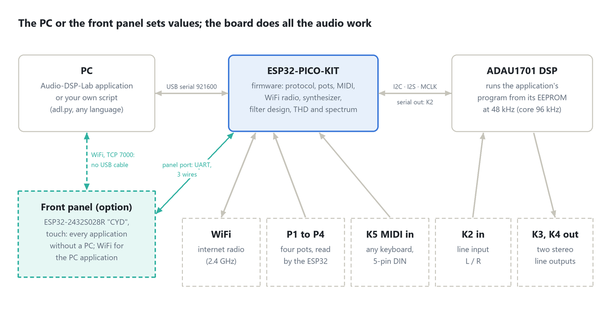

# Installation guide

As of 2026-10-22, for firmware 1.2 and application 1.2.

This guide takes you from an Elektor Audio-DSP-FX board to a running Audio-DSP-Lab: prepare the board, flash the firmware, install the application, connect. Plan about 20 minutes. Everything you need to download is at **[github.com/andiepp/Audio-DSP-Lab](https://github.com/andiepp/Audio-DSP-Lab)**.



## What you need

| Item | Notes |
| --- | --- |
| Elektor Audio-DSP-FX board v2.2 | ADAU1701 DSP with an ESP32-PICO-KIT V4 (ESP32-PICO-D4) or the newer ESP32-PICO-KIT-1 (ESP32-PICO-V3); the firmware tells them apart by itself. Elektor article "Audio DSP FX Processor Board" (230510) |
| USB cable | Micro-USB **data** cable for the ESP32 kit; charge-only cables do not work |
| Windows PC | Windows 10 or 11, 64-bit. Nothing else to install: the application brings its own .NET runtime |
| Headphone amplifier or active speakers | For K3/K4, line level (about 0.9 Vrms at full scale) |
| Optional: 2.4 GHz WiFi | For the internet radio |
| Optional: MIDI keyboard | With a 5-pin DIN MIDI Out, and a DIN-to-3.5 mm TRS type A cable, for the synthesizer |
| Optional: SigmaStudio and USBi | Analog Devices SigmaStudio 4.7 and the USBi programmer, for your own DSP programs |

## 1. Prepare the board

The firmware drives the DSP's clock and its boot. Set two jumpers:

| Jumper | Setting | Why |
| --- | --- | --- |
| **JP1** (DSP clock) | **ext. MCLK** | The ESP32 supplies the DSP's master clock (12.288 MHz on GPIO0), so the DSP and the ESP32's audio (radio, generator, synthesizer) run on one clock. On the crystal (X1) the DSP runs on a clock of its own, and the audio the ESP32 sends drifts against it. |
| **JP2** (boot) | **Selfboot** | The DSP loads each application's program from its EEPROM. |

Every application works on a board as Elektor ships it, with either ESP32 kit; no modification is needed.

Leave SigmaStudio's USBi off the I2C header unless you are working in SigmaStudio: while it sits on the bus, the firmware cannot write the EEPROM.

## 2. Connect the board and check the driver

Plug the ESP32 kit's micro-USB socket into the PC. Windows normally installs the driver of the kit's USB-serial chip by itself (Silicon Labs CP210x). Check in the Device Manager under **Ports (COM & LPT)**: you should see **Silicon Labs CP210x USB to UART Bridge (COMn)**. Note the number n.

No such entry, or a yellow warning sign? Install the **CP210x Universal Windows Driver** from Silicon Labs (silabs.com, "CP210x USB to UART Bridge VCP Drivers"), then unplug and replug the board.

## 3. Flash the firmware

Download the latest release from the project's **Releases** page, **[github.com/andiepp/Audio-DSP-Lab/releases](https://github.com/andiepp/Audio-DSP-Lab/releases)**: under the release's **Assets**, `Audio-DSP-Lab-<version>-windows-x64.zip` holds the application, the firmware and the documents. Unzip it into a folder of your choice, for example `Documents\Audio-DSP-Lab`. The folder then holds `AudioDspLab.exe`, `firmware` and `docs`.

**Not the source code.** GitHub's green **Code** button (**Download ZIP**) and the release's **Source code (zip)** give you the repository, with folders such as `app`, `CAD` and `sigmastudio`. It has no built application and no firmware images; you need it only for [building from source](Building.md).

Close every program that might use the board's port: the Arduino IDE's serial monitor, a terminal, the Audio-DSP-Lab application.

### Option A: the flash tool (recommended)

1. Open the `firmware` folder and double-click **Flash-Firmware.cmd**.
2. It lists the serial ports; type the board's port (for example `COM5`) and press Enter.
3. Wait for `Done.` (about 30 s). The board restarts with the new firmware.

The tool needs Espressif's **esptool**. It finds it by itself if the Arduino IDE with the ESP32 core is installed. Otherwise either put `esptool.exe` into the `firmware` folder (from github.com/espressif/esptool, Releases, the Windows zip) or install it with Python: `pip install esptool`.

From a terminal in the `firmware` folder you can give the port, and options, directly. In **PowerShell**, put `.\` in front: PowerShell runs nothing from the current folder by its bare name.

```
.\Flash-Firmware.cmd COM5
```

In a classic **Command Prompt** (cmd.exe) the `.\` is not needed: `Flash-Firmware.cmd COM5`.

Options after the port: `-Erase` wipes the whole flash first (every stored setting goes), `-Baud 115200` helps with a slow USB hub, for example `.\Flash-Firmware.cmd COM5 -Erase`. If esptool cannot enter the boot loader, hold the **BOOT** button of the ESP32 kit while flashing starts.

The flash tool keeps what the board has stored: the WiFi networks, your stations, the analysis' Frequency Response reference and the copy of your SigmaStudio program.

### Option B: in the browser, without installing anything

Chrome or Edge can flash the ESP32 directly:

1. Open Espressif's web flasher, **espressif.github.io/esptool-js**.
2. Set the baud rate to 460800, press **Connect** and choose the board's port.
3. Under **Flash Address** enter `0x0` and choose `firmware\AudioDspLab-merged.bin`.
4. Press **Program** and wait until it is done, then press the kit's **EN** button (or replug the board).

The merged image overwrites the whole flash, so stored settings are lost; that is fine for a first installation.

### Option C: build it yourself

See [Building.md](Building.md): Arduino IDE 2 with the ESP32 core 3.3.10, board **ESP32 PICO-D4**, partition scheme **Minimal SPIFFS**, the libraries from `firmware/libraries`.

## 4. Install and start the application

There is no installer: `AudioDspLab.exe` in the unzipped release folder is the whole application. No `AudioDspLab.exe` in your folder? Then you unzipped the source code: download `Audio-DSP-Lab-<version>-windows-x64.zip` from the release's **Assets** (step 3).

1. Double-click **AudioDspLab.exe**. The first time, Windows SmartScreen may warn about an unknown publisher (the program is not code-signed): choose **More info**, then **Run anyway**.
2. Under **Board on**, choose the board's COM port and press **Connect**.
3. The status line shows `Connected to COM5: Audio-DSP-Lab 1.2.` and the application row shows **SigmaStudio** running: the board starts in SigmaStudio mode at every power-up.

The application remembers the port and connects by itself next time. It keeps its own files in `%LocalAppData%\Audio-DSP-Lab` (the stored settings and the last port). To uninstall, delete the folder you unzipped and that one.

## 5. First check: a tone

1. Connect K3 to an amplifier or active speakers, at low volume.
2. Press **Generator**, wait for `running`.
3. Press **Output on**. You hear a 1 kHz sine at −20 dBFS.
4. Turn the frequency's digits with the mouse wheel; press **Pot control on** and turn P1 and P2 on the board: the window follows.

If **Generator** fails, see [Troubleshooting](#troubleshooting).

### A first measurement (optional)

A stereo cable from K3 to K2 (output to line input) lets the board measure itself:

1. Press **Analysis**, wait for `running`.
2. **Measure: Frequency Response**, **Start sweep**: the curve lies flat at about −27 dBFS from 20 Hz to 20 kHz (the loop loses about 7 dB at the output level of −20 dB). Tick **Replace the reference** and press **Keep as reference**: later sweeps of a device can subtract the board's own response.
3. **Measure: THD**, **Start measuring**: at the output level −20 dB THD+N is about 0.05 %, at 0 dB about 0.017 % with THD about 0.016 %. These are the board's own figures, the floor for any device you measure later.
4. **Measure: Spectrum**, with the cable out of K2 and **Output off**: the input's noise is about −97 dBFS RMS, and mains hum shows near 50 Hz.

The manual's chapter "Analysis" explains the three parts.

## 6. WiFi for the radio

1. Press **WiFi networks …** (right column) or **WiFi** on the radio strip.
2. Enter your network's name (SSID) and password under **Network 1**, press **Save**. Network 2 is an optional fallback, such as a phone's hotspot.
3. Press **Radio**. The connection goes from `WiFi …` to `Stream …` to `Playing`; press **Output on**.

The ESP32 uses 2.4 GHz networks only, with a password (WPA2-Personal) or none; enterprise networks that ask for a user name do not work. The board keeps the networks across power cycles and firmware updates; the password is never shown again.

## 7. A MIDI keyboard for the synthesizer

Connect the keyboard's 5-pin DIN MIDI Out to K5 with a DIN-to-3.5 mm cable of **type A** (DIN pin 4 to the ring, pin 5 to the tip, pin 2 to the sleeve). Set the keyboard to send on MIDI channel 15, or change **MIDI channel** on the synthesizer page. Details are in the manual, chapter "The synthesizer".

## 8. Optional: SigmaStudio

For your own DSP programs, install Analog Devices **SigmaStudio 4.7** and connect the **USBi** to the board's I2C header. Select **SigmaStudio** in the application (or let the board start in it): the DSP then runs your program from the EEPROM and you can download and write the EEPROM at any time. See [SigmaStudio.md](SigmaStudio.md).

## 9. Optional: the front panel

A touch panel on an ESP32-2432S028R ("CYD") display board runs the applications without a PC and lets the PC application work over WiFi. Three wires connect it to the board (CYD GPIO22 to the board's GPIO37, CYD GPIO35 to GPIO4, and GND); `firmware\Flash-Panel.cmd` writes its firmware over the CYD's own USB port. Wiring, power and use: the manual's chapter "The front panel", or [the front panel guide](Panel.md).

## Updating

- **Firmware:** flash the new release with the flash tool (Option A). Stored settings stay.
- **Application:** replace `AudioDspLab.exe` with the new one.
- **Front panel:** flash its firmware from the same release (`Flash-Panel.cmd`); the panel shows what its board offers, so update both together.

Firmware and application of the same release belong together; the application tells you if the board speaks another protocol version.

## Going back to other firmware

Audio-DSP-Lab does not lock the board: flash any other sketch (Elektor's demos, your own) as usual. The EEPROM keeps the DSP program that ran last, so the DSP still boots it until another program is written; in SigmaStudio mode that is your own program.

## Troubleshooting

| Symptom | Cause | Fix |
| --- | --- | --- |
| No `AudioDspLab.exe` in the unzipped folder, only `app`, `CAD`, `docs`, `firmware`, `sigmastudio`, `tools` | The source code was downloaded (the **Code** button or **Source code (zip)**), not the release | Download `Audio-DSP-Lab-<version>-windows-x64.zip` from the release's **Assets** |
| No COM port appears | Charge-only cable, or no driver | Use a data cable; install the CP210x driver |
| Flash tool: "esptool was not found" | No Arduino IDE, no Python | Put `esptool.exe` into the `firmware` folder, or `pip install esptool` |
| Flash tool: "Failed to connect to ESP32" | The port is held by another program, or the kit did not enter its boot loader | Close the other program; hold BOOT while flashing starts; try `-Baud 115200` |
| The application: "COMn is in use by another program" | A serial monitor or terminal holds the port | Close it |
| The application: "No Audio-DSP-Lab board answers" | A new board runs Elektor's or no firmware; a board flashed from the Arduino IDE with other settings (another partition scheme) may not start | Flash the release with the flash tool (step 3), which also writes the right partition table; press **Connect** again |
| Every application fails with `dsp-not-responding` | JP1 not on ext. MCLK, or JP2 not on Selfboot | Set the jumpers as in step 1 |
| Every application fails with `eeprom-failed` | The USBi sits on the I2C header | Unplug it, select again |
| No sound | Output off, or the amplifier on K4 while you listen to K3 | Press **Output on**; K3 and K4 carry the same signal |
| Windows asks for a "BOOT" device or the board resets when connecting | A USB-serial adapter that pulses DTR/RTS | Use the ESP32 kit's own USB socket |
| After plugging the board in it does not answer, or SigmaStudio mode shows `eeprom-failed` | A front panel with its own supply kept the unplugged board half powered through its cable (panel firmware before this release) | Press the kit's **EN** button; update the panel's firmware, or power board and panel together |
| THD reads a fundamental of a few dozen Hz far below −60 dBFS | Nothing returns on K2: no cable, or the output off | Connect K3 to K2 (or the device under test), press **Output on** |
