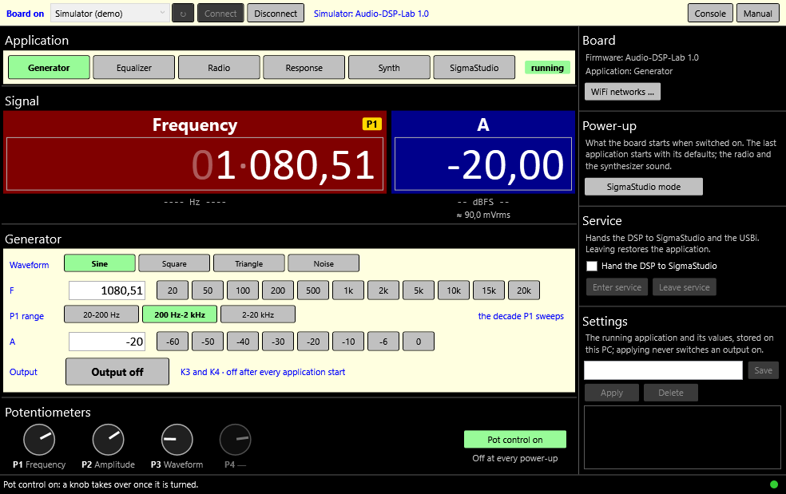
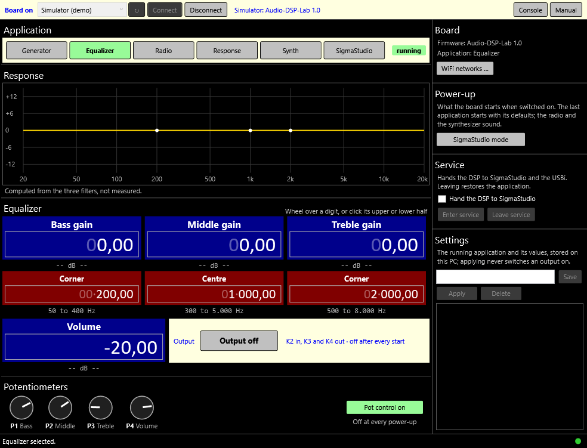
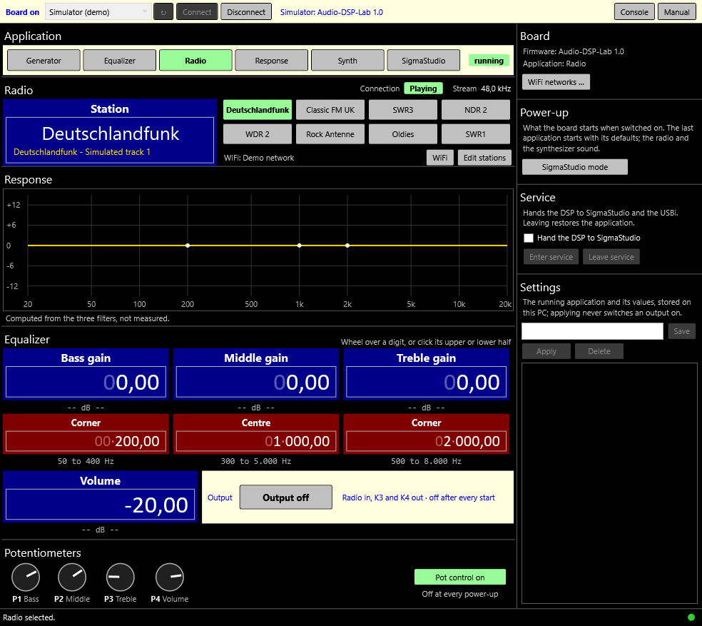
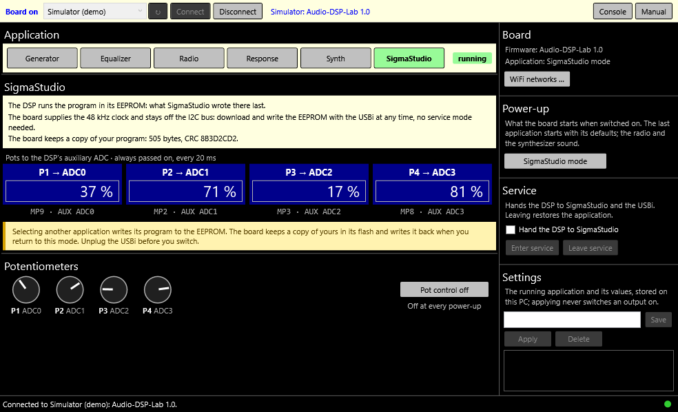
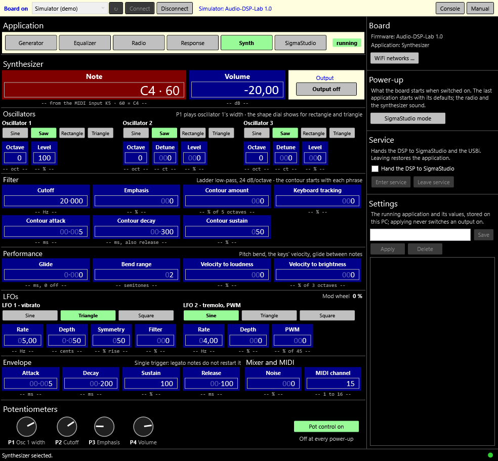
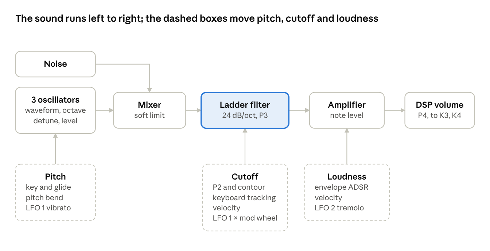

# Manual

As of 2026-10-17.

Audio-DSP-Lab turns the Elektor Audio-DSP-FX board into six audio instruments that you run from a Windows PC over USB: a signal generator, an equalizer, an internet radio, a frequency response analyzer, a SigmaStudio mode for your own DSP programs, and a Minimoog-style synthesizer. This manual covers firmware 1.0 and application 1.0.

## At a glance

Audio-DSP-Lab has two parts:

- **The firmware** runs on the board's ESP32. It writes each application's DSP program into the ADAU1701's EEPROM, computes filter coefficients, reads the pots and MIDI, streams the radio and generates the synthesizer's sound. It talks to the PC over the board's USB port with a simple text protocol.
- **The application** (`AudioDspLab.exe`) is the PC's front panel. It shows one page per application, sets every value, and shows what the board reports, including the changes you make with the board's pots.

The board keeps working without the PC: once an application runs, you can close the window and keep playing. The board can also start an application by itself at power-up.

| Application | What it does | Audio |
| --- | --- | --- |
| Generator | Sine, square, triangle or noise, 20 Hz to 20 kHz | out K3, K4 |
| Equalizer | Bass, middle, treble and volume on the line input | in K2, out K3, K4 |
| Radio | Eight MP3 internet stations over WiFi, through the equalizer | out K3, K4 |
| Response | Sweeps a sine through a device under test and plots its response | out K3, K4, in K2 |
| SigmaStudio | Runs your own SigmaStudio program from the EEPROM | as your program |
| Synthesizer | A monophonic synthesizer played from a MIDI keyboard | MIDI in K5, out K3, K4 |

Before you start, the board needs the firmware and two jumper settings: see the [installation guide](Installation.md).

## The board

| Part | Function | Notes |
| --- | --- | --- |
| K2 | Line input, left ADC0, right ADC1 | About 22.5 kΩ input impedance |
| K3 | Output DAC0 / DAC1 | Every application's output; about 0.9 Vrms at full scale |
| K4 | Output DAC2 / DAC3 | The same signal as K3 |
| K5 | MIDI input, 3.5 mm TRS type A | DIN pin 4 to ring, pin 5 to tip, pin 2 to sleeve |
| P1 to P4 | Potentiometers | What each sets depends on the application (see [The pots](#the-pots)) |
| USB | Serial port of the ESP32 kit (Silicon Labs CP210x) | The application's connection |
| I2C header | SigmaStudio's USBi | Only for SigmaStudio mode and service mode |
| JP1 | DSP clock | On **ext. MCLK**: the ESP32 supplies the clock |
| JP2 | DSP boot | On **Selfboot** |

The DSP samples at 48 kHz; its core runs four times per sample (192 kHz), and every frequency the firmware computes is computed for that rate. Levels are given in dBFS: 0 dBFS is the DSP's full scale.

## Getting started

1. Connect the board's USB socket (on the ESP32 kit) to the PC.
2. Start **AudioDspLab.exe**.
3. Choose the board's COM port under **Board on** and press **Connect**. The application remembers the port and connects to it by itself next time.
4. Pick an application under **Application**. The badge at the right of that row shows its state: `loading`, then `running`.
5. Set the values, then press **Output on**. Every application starts with its output off.

At power-up the board starts in SigmaStudio mode, unless you set **Power-up** to **Last application** (see [Power-up](#power-up)).

No board at hand? Choose **Simulator (demo)** as the port. The simulator behaves like a board with made-up measurements, so you can try every page.

### The window

| Area | What it shows or does |
| --- | --- |
| Board on (top) | The port, **Connect** and **Disconnect**, the firmware found; **Console** talks the protocol by hand, **Manual** opens this document |
| Application | One key per application, and the state badge |
| The page | The running application's values: displays, dials, keys, its **Output** key |
| Potentiometers | P1 to P4, where each stands and what it drives now, and the **Pot control** key |
| Board (right) | Firmware, application, the WiFi networks |
| Power-up | What the board starts when it is switched on |
| Service | Hands the DSP to SigmaStudio and the USBi |
| Settings | Stored settings: save, apply, delete |
| Status line (bottom) | The last action and its result; the dot is green while connected, red after an error |

**Digit dials.** Every numeric value is a digit dial: turn the mouse wheel over a digit, or click its upper or lower half, to step that digit. The board answers every change with the value it took, and the dial shows that value.

**Pot badges.** A gold badge such as **P2** lights on a display for a moment when the board's pot changed that value, not the window.

## The applications

Selecting an application writes its DSP program into the EEPROM (about 0.2 s; nothing is written if the program is already there) and boots the DSP. The output is off after every start.

### Generator

A test signal on K3 and K4.

| Control | Range | Default | Pot |
| --- | --- | --- | --- |
| Waveform | Sine, square, triangle, noise | Sine | P3, four zones |
| Frequency | 20 Hz to 20 kHz, 0.01 Hz steps | 1 kHz | P1, logarithmic within the P1 range |
| P1 range | 20–200 Hz, 200 Hz–2 kHz, 2–20 kHz | 200 Hz–2 kHz | – |
| Amplitude | −60 to 0 dBFS | −20 dBFS | P2 |
| Output | Off, on | Off | – |

Type a frequency into the **F** box (a trailing `k` means kilohertz) and press Enter, or use the keys beside it. Waveform changes fade and amplitude changes glide, so neither clicks. The square wave is not band-limited and aliases at high frequencies. The line under the amplitude gives the approximate RMS voltage, from Elektor's 0.9 Vrms at full scale.

### Equalizer

The line input K2 through bass, middle and treble to a volume, the same stereo signal on K3 and K4. The curve at the top is computed from the three filters, not measured.

| Control | Range | Default | Pot |
| --- | --- | --- | --- |
| Bass gain / corner | ±12 dB / 50–400 Hz (low shelf) | 0 dB / 200 Hz | P1 (gain) |
| Middle gain / centre | ±12 dB / 300 Hz–5 kHz (peak, Q 0.7) | 0 dB / 1 kHz | P2 (gain) |
| Treble gain / corner | ±12 dB / 500 Hz–8 kHz (high shelf) | 0 dB / 2 kHz | P3 (gain) |
| Volume | −60 to 0 dB | −20 dB | P4 |
| Output | Off, on | Off | – |

### Radio

MP3 internet radio over WiFi, decoded on the ESP32 and played through the equalizer's bands and volume, so the equalizer page and its pots work as above. The radio strip above them shows the station, the stream title, the connection and the stream's sample rate.

**WiFi first.** The radio needs a WiFi network. Press **WiFi** (in the radio strip, or **WiFi networks …** on the right), enter the network's name and password and press **Save**. The board keeps up to two networks and tries the first one first. The password goes to the board once and is never shown again. The ESP32 only uses 2.4 GHz networks.

The default stations:

| Key | Station | Key | Station |
| --- | --- | --- | --- |
| 0 | Deutschlandfunk | 4 | WDR 2 |
| 1 | Classic FM UK | 5 | Rock Antenne |
| 2 | SWR3 | 6 | Oldies (181.FM Super 70s) |
| 3 | NDR 2 | 7 | SWR1 |

**Your own stations.** **Edit stations** opens the eight stations' names and URLs. Change a row and press its **Save**: the board keeps the station across power cycles and firmware updates. **Default** gives one row its default back, **Restore all defaults** all of them.

The radio plays MP3 streams over plain HTTP. Streams that are only offered over `https://`, AAC streams and playlist URLs (`.m3u`, `.pls`) do not play. Many stations list a plain `http://` MP3 address on their website or in directories such as radio-browser.info.

| Connection | Meaning |
| --- | --- |
| WiFi … | Connecting to a network |
| Stream … | Opening the station's stream |
| Playing | Sound; the rate shows beside it |
| No network | No network set, or neither network answers (retried every 30 s) |
| Stream error | The station did not deliver (retried every 5 s) |

### Response

Measures a device's frequency response: a sine leaves on K3/K4, passes the device under test and returns on K2, and the board reads the level of both channels at each frequency.

1. Connect K3 straight to K2 with a cable, run a sweep, tick **Replace the reference** and press **Keep as reference**.
2. Put the device between K3 (or K4) and K2 and press **Start sweep**. The curve grows point by point.
3. Choose **Relative to reference** to see the device's own response, without the board's.

| Control | Range | Default |
| --- | --- | --- |
| Output level | −60 to 0 dBFS (P2) | −20 dBFS |
| Sweep start / stop | 20 Hz to 20 kHz | 20 Hz / 20 kHz |
| Points per decade | 1 to 40 (up to 121 points over 20 Hz to 20 kHz) | 10 |
| Tone between sweeps | 20 Hz to 20 kHz | 1 kHz |

A full sweep at 10 points per decade takes about 10 s; the line under the points per decade gives the estimate. Between sweeps the board plays the tone and the window shows the input levels twice a second. The reference is kept in the board and survives power cycles. Mind the common ground between K3 and K2; the measurement's floor is about −110 dBFS.

### SigmaStudio mode

The DSP runs whatever SigmaStudio last wrote to its EEPROM. The firmware supplies the 48 kHz clock and stays off the I2C bus, so you can download programs and write the EEPROM with the USBi at any time. The pots are always passed to the DSP's auxiliary ADC: P1 to ADC0, P2 to ADC1, P3 to ADC2, P4 to ADC3, every 20 ms.

Selecting another application writes its program over yours, but the firmware first keeps a copy of yours in its flash and writes it back when you return to this mode. **Unplug the USBi before you switch.** Confirm every EEPROM write in SigmaStudio. How to build your own programs for the board is described in [SigmaStudio.md](SigmaStudio.md).

### Synthesizer

See the chapter [The synthesizer](#the-synthesizer) below.

## Pots, stored settings, power-up and service mode

### The pots

The pots set values only while **Pot control** is on, and it is off at every power-up. SigmaStudio mode is the exception: there the pots always go to the DSP's auxiliary ADC.

| Application | P1 | P2 | P3 | P4 |
| --- | --- | --- | --- | --- |
| Generator | Frequency | Amplitude | Waveform | – |
| Equalizer, Radio | Bass gain | Middle gain | Treble gain | Volume |
| Response | – | Output level | – | – |
| SigmaStudio | ADC0 | ADC1 | ADC2 | ADC3 |
| Synthesizer | Oscillator 1 width | Cutoff | Emphasis | Volume |

- After the window writes a value, or after Pot control is switched on, a pot takes the value back only once you move it by about 2 % of its travel: a pot that merely sits there never overwrites the window's value.
- Once a pot has taken over it follows with a small backlash, so its noise does not make the value flicker; both ends stay reachable.
- With Pot control off, every start uses the defaults. With it on, every start takes the pots' positions.

### Stored settings

The Settings block saves the running application and its values under a name, and applies them again later: double-click a name or press **Apply**. Applying selects the stored application if another runs, and never switches an output on. The radio's stations and WiFi networks are not part of a set: they belong to the board.

Sets are kept on the PC in `%LocalAppData%\Audio-DSP-Lab\Settings`, one text file each (`name=value` lines, the protocol's own words). Copy a file to take a set to another PC.

### Power-up

The **Power-up** key chooses what the board starts when it is switched on. The choice is kept in the board.

| Key shows | At power-up the board starts |
| --- | --- |
| **SigmaStudio mode** (the default) | SigmaStudio mode, whatever ran before |
| **Last application** | The application you selected last, with its defaults |

- With **Last application**, the radio and the synthesizer come up sounding: their output is switched on, at the default volume of −20 dB. The generator and the response analyzer stay off, since they may drive a device under test.
- Service mode is never restored, and Pot control is off at every power-up.
- Before another application's program replaces yours at power-up, the firmware keeps a copy of your SigmaStudio program. If the chosen application cannot start, the board starts SigmaStudio mode instead and the window shows the error.
- **Last application** lets the board play the radio, or wait for the keyboard, as soon as it is powered, with no PC at all: a USB power supply is enough.

### Service mode

Service mode hands the DSP to SigmaStudio while an application's program runs: the firmware releases the EEPROM's write protection, holds SELFBOOT low and leaves the I2C bus, so SigmaStudio and the USBi can download and tune the application's own SigmaStudio project.

1. Tick **Hand the DSP to SigmaStudio** and press **Enter service**.
2. Work in SigmaStudio with the USBi on the I2C header.
3. **Unplug the USBi**, then press **Leave service**. The firmware writes the application's program back and restarts it; whatever SigmaStudio wrote to the EEPROM meanwhile is replaced.

While the USBi sits on the bus, every EEPROM write of the firmware fails (`eeprom-failed`), even with SigmaStudio closed. For your own programs use SigmaStudio mode instead: it needs no service mode.

## The synthesizer

The synthesizer is one monophonic voice in the spirit of the Minimoog Model D, computed on the ESP32 at 48 kHz and played from any MIDI keyboard on the MIDI input K5. Every default leaves a plain, bright sawtooth: you add what you want from there.

### The MIDI keyboard

The synthesizer listens to plain MIDI, so any keyboard with a 5-pin DIN MIDI Out can play it.

| The keyboard's control | MIDI message | What it does here | Needed |
| --- | --- | --- | --- |
| Keys | Note on, note off | Plays the voice; the last key held wins | Yes |
| Key velocity | Velocity of the note on | Loudness and brightness, as far as set | No |
| Pitch bend wheel | Pitch bend | Bends all oscillators by up to the bend range | No |
| Mod wheel | Controller 1 | Vibrato, and LFO 1 on the filter | No |

- **The cable:** every standard MIDI Out uses the same pins of the 5-pin DIN socket: pin 4 the current source, pin 5 the data line, pin 2 the shield. The cable to K5 takes pin 4 to the ring, pin 5 to the tip and pin 2 to the sleeve of the 3.5 mm plug (TRS type A).
- **The channel:** the keyboard must send on the channel set as **MIDI channel**, 15 by default.
- **Other outputs:** a keyboard with only USB MIDI needs a USB MIDI host interface with a DIN MIDI Out. A keyboard with a 3.5 mm MIDI Out of type A can use a type A TRS cable straight to K5; a type B output needs a B-to-A adapter.

### Setting up

1. Connect the keyboard's **5-pin DIN MIDI Out** to K5 with the cable described above. Some keyboards (the Arturia KeyStep 37, for instance) also have 3.5 mm jacks for sync and CV: those are not MIDI.
2. Set the keyboard to send on MIDI channel 15, or set **MIDI channel** to the keyboard's channel.
3. Select **Synth**, set **Volume** (about −20 dB to start) and press **Output on**.
4. Play. The **Note** display shows the note sounding (60 = C4), and the LFO header shows the mod wheel's position.

A key sounds within a few milliseconds: the audio path holds about 5 ms.

### How the voice works

The sound runs through the same stages as on a Minimoog: oscillators and noise into a mixer, a 24 dB/octave ladder low-pass filter shaped by its own envelope (the contour), and an amplifier shaped by the loudness envelope. Two LFOs and the keyboard's pitch bend, mod wheel and velocity modulate it; the DSP sets the final volume.

The filter is where most of the character comes from: its cutoff is moved by P2, the contour, the keyboard, velocity and LFO 1 at once.

### Oscillators

| Control | Range | Default | Notes |
| --- | --- | --- | --- |
| Waveform (each) | Sine, saw, rectangle, triangle | Saw | Chosen with the keys |
| Octave (each) | −2 to +2 | 0 | |
| Detune (oscillators 2, 3) | ±700 cents | 0 | Relative to oscillator 1; a few cents give the classic beating |
| Level (each) | 0 to 100 % | 100, 0, 0 | Oscillators 2 and 3 are silent until you raise them |
| Width (each, rectangle) | 5 to 95 % | 50 % | The high part of the cycle: 50 % is a square, 25 % a narrow pulse. P1 plays oscillator 1's |
| Rise (each, triangle) | 10 to 90 % | 50 % | The rising part of the cycle: 50 % is a symmetric triangle; towards either end it leans into a brighter ramp |

Each oscillator shows one shape dial beside its level: **Width** while the rectangle is selected, **Rise** while the triangle is; sine and saw have none. Saw and rectangle are band-limited at their edges and the triangle at its corners, so high notes do not alias.

### Mixer and MIDI

| Control | Range | Default | Notes |
| --- | --- | --- | --- |
| Noise | 0 to 100 % | 0 | White noise into the mixer |
| MIDI channel | 1 to 16 | 15 | Notes on other channels are ignored |

Each source at 100 % plays at −6 dBFS. Above that the sum bends softly toward full scale instead of clipping, as the Minimoog's mixer overdrives: three oscillators at full level sound thicker, not distorted.

### Filter

| Control | Range | Default | Notes |
| --- | --- | --- | --- |
| Cutoff | 20 Hz to 20 kHz | 20 kHz (open) | P2, logarithmic |
| Emphasis | 0 to 100 % | 0 | P3. Grows nasal, then whistles; at 100 % the filter rings on its own |
| Contour amount | 0 to 100 % | 0 | How far the contour opens the filter: 100 % = +5 octaves |
| Contour attack | 1 ms to 10 s | 5 ms | |
| Contour decay | 1 ms to 10 s | 300 ms | Also the contour's release |
| Contour sustain | 0 to 100 % | 50 % | |
| Keyboard tracking | 0 to 100 % | 0 | At 100 % the cutoff follows the keyboard one octave per octave, around C4 |

The contour starts with the first key of a phrase, together with the loudness envelope.

### Envelope

| Control | Range | Default |
| --- | --- | --- |
| Attack | 1 ms to 10 s | 5 ms |
| Decay | 1 ms to 10 s | 200 ms |
| Sustain | 0 to 100 % | 100 % |
| Release | 1 ms to 10 s | 100 ms |

The attack rises in a straight line; decay and release fall exponentially and come within 1 % of their target in the time set. The envelope is **single trigger**, as on the Minimoog: a key pressed while another is held changes only the pitch, so legato phrases do not restart it.

### LFOs and the mod wheel

| Control | Range | Default | Notes |
| --- | --- | --- | --- |
| LFO 1 waveform / rate | Sine, triangle, square / 0.1 to 20 Hz | Triangle / 5 Hz | |
| LFO 1 depth (vibrato) | 0 to 1200 cents | 50 cents | Pitch, scaled by the mod wheel |
| LFO 1 filter | 0 to 100 % | 0 | Cutoff, scaled by the mod wheel: 100 % = ±2 octaves |
| LFO 2 waveform / rate | Sine, triangle, square / 0.1 to 20 Hz | Sine / 4 Hz | |
| LFO 2 depth (tremolo) | 0 to 100 % | 0 | Loudness, always on |
| LFO 2 PWM | 0 to 100 % | 0 | Moves every rectangle's width, always on: 100 % = ±45 points |
| Width (each LFO, square) | 5 to 95 % | 50 % | The square's high part: short pulses give a chopped tremolo |
| Symmetry (each LFO, triangle) | 0 to 100 % | 50 % | The rise's part: 0 % is a falling ramp, 100 % a rising one |

**PWM** (pulse-width modulation) gives a rectangle the slow, chorus-like movement of the classic polysynths: try oscillator 1 as a rectangle at 50 %, LFO 2 at about 0.8 Hz and PWM at 60 %. The mod wheel is at 0 after every start, so there is no vibrato until you touch it.

### Performance

| Control | Range | Default | Notes |
| --- | --- | --- | --- |
| Glide | 0 to 5 s | 0 (off) | Slides to each new note, within 1 % of the interval in the time set |
| Bend range | 0 to 12 semitones | 2 | How far the pitch bend wheel bends, either way |
| Velocity to loudness | 0 to 100 % | 0 | At 100 % the loudness follows the velocity |
| Velocity to brightness | 0 to 100 % | 0 | A hard key opens the filter: 100 % = +3 octaves at full velocity |

### Starting points

Start from the defaults, then change only what the row lists.

| Sound | Settings |
| --- | --- |
| Fat lead | Oscillator 2 saw, level 100 %, detune +7 cents; oscillator 3 saw, level 100 %, detune −7 cents; cutoff 3 kHz; glide 80 ms |
| Bass pluck | Oscillator 3 rectangle (width 50 %), octave −1, level 100 %; cutoff 150 Hz, emphasis 40 %, contour amount 80 %, contour sustain 0 %; decay 400 ms, sustain 0 % |
| Slow wah | Cutoff 300 Hz, emphasis 60 %, contour amount 70 %, contour attack 1.5 s, contour decay 2 s |
| Wobble | Cutoff 500 Hz, emphasis 50 %, LFO 1 filter 60 %, LFO 1 rate 3 Hz, LFO 1 depth 0; push the mod wheel up |
| Expressive keys | Velocity to loudness 60 %, velocity to brightness 40 %, cutoff 1 kHz |
| Moving pulse | Oscillator 1 rectangle, width 50 %; LFO 2 rate 0.8 Hz, PWM 60 % |
| Hollow reed | Oscillator 1 rectangle, width 15 %; cutoff 2 kHz, emphasis 30 % |

Save a sound you like with **Settings → Save**.

### Behaviour worth knowing

- **Last-note priority:** a new key takes over; releasing it returns to a key still held, at once and without a new attack.
- **Silence:** MIDI controllers 120 (all sound off) and 123 (all notes off) silence the voice; changing the MIDI channel does too.
- **Load:** the voice takes about 4 % of the ESP32's audio time when silent and about 40 % at peak with two oscillators through the filter.

## Scripting and the console

Everything the window does goes through the board's text protocol, described in [Protocol.md](Protocol.md). You can use it yourself:

- **Console** (top right of the window) sends requests by hand and shows the answers and the board's events. Try `help`, `params`, `get`, `set frequency 440`.
- **[tools/adl.py](../tools/adl.py)** is a Python client: `python adl.py COM5 "app generator" "set output on"`, or `from adl import Board` in your own scripts. It needs pyserial.
- Any serial terminal at 921600 baud works too, with DTR and RTS off. Only one program can own the port at a time: disconnect the application first.

## Troubleshooting

| Symptom | Likely cause | Fix |
| --- | --- | --- |
| The port is not in the list | The CP210x driver is missing, or a charge-only USB cable | Install the driver (see the installation guide), use a data cable, press ↻ |
| "COMn is in use by another program" | Arduino's serial monitor, a terminal or another Audio-DSP-Lab holds the port | Close it, then Connect |
| "No Audio-DSP-Lab board answers" | The board runs other firmware, or JP1 is not on ext. MCLK | Flash the firmware; check the jumpers |
| No sound after selecting an application | The output is off after every start | Press **Output on**; check volume or amplitude |
| The application fails with `eeprom-failed` | SigmaStudio's USBi is still on the I2C header | Unplug the USBi and select again |
| The application fails with `dsp-not-responding` | JP1 on the crystal instead of ext. MCLK, JP2 not on Selfboot | Set the jumpers as in the installation guide |
| After a power cycle the board is in SigmaStudio mode | **Power-up** shows SigmaStudio mode, or the last application could not start | Select the application again, or set **Power-up** to **Last application** |
| Radio shows "No network" | No WiFi network set, a 5 GHz network, or out of reach | **WiFi**: enter a 2.4 GHz network |
| A station of your own stays at "Stream error" | The URL is `https://` only, AAC, a playlist, or no longer served | Find the station's plain `http://` MP3 stream |
| Synthesizer silent, Note stays `---` | No MIDI arrives: wrong cable or plug, or a jack that is not MIDI | Use the keyboard's DIN MIDI Out and a type A cable (pin 4 ring, pin 5 tip) |
| Notes arrive but the synthesizer stays silent | The keyboard sends on another channel, or the output is off | Set **MIDI channel**; press **Output on** |
| Vibrato or LFO 1 filter does nothing | The mod wheel is at 0 after every start | Push the mod wheel up |
| Your SigmaStudio program is gone after using an application | The copy failed (USBi on the bus) or an EEPROM write did not land | Return to SigmaStudio mode (the copy is written back); confirm writes in SigmaStudio |
| "The board restarted" in the status line | A power dip, a reset, or a crash | The window reads everything again; if it repeats, use a better USB port or supply |

## Technical notes

- **The DSP's core rate.** The SigmaStudio projects run the ADAU1701's core four times per 48 kHz sample (192 kHz). Every frequency the firmware computes (oscillators, filters) is computed for that rate; frequencies typed into SigmaStudio's own controls for these projects act four times higher.
- **The clock.** With JP1 on ext. MCLK the ESP32 supplies 12.288 MHz (256 × 48 kHz). The radio drives the clock from its stream's rate instead (256 × 44.1 kHz for most stations), and the equalizer's filters are recomputed for it.
- **What the board stores** in the ESP32's flash: the WiFi networks, the stations, the analyzer's reference, the power-up choice, and the copy of your SigmaStudio program. Flashing a firmware update with the flash tool keeps them; erasing the flash removes them.
- **The pots** are read by the ESP32 (12-bit, smoothed). The DSP sees them only through the ESP32's DACs in SigmaStudio mode.
